# Grid-Aware Smart Charging Scheduling for Electric Vehicles: A Convex Optimization Approach

**Optimization Techniques — Group 1**
Tarun Thomas Tom (B230589EC) · Milan V Raj (B231080EC) · Nirmal Thomas Mathew (B231138EC)

---

## Abstract

Uncontrolled EV charging, where every car draws full power as soon as it plugs in, creates sharp demand peaks, high demand charges and overloads on transformers and phases. Workplace EVs are usually parked much longer than they need to charge, though, so the charging load is flexible. We formulate EV charging as a family of convex programs over per-vehicle charging currents:

- a **time-of-use cost LP**, with an optional demand-charge term;
- a **valley-filling QP**;
- a **phase-balancing QP** that penalises negative-sequence current;
- a **robust LP** that hedges against on-site solar and price uncertainty with a Bertsimas–Sim budget.

All models enforce the site's three-phase network limits exactly, as second-order cone (SOC) constraints on current phasors.

We evaluate the models in the **ACN-Sim** simulator, using **1,772 real charging sessions** from the Caltech ACN garage (19 weekdays of September 2018) and the SCE TOU-EV-4 tariff. The schedulers run as an online model-predictive controller that re-solves every 5 minutes. We compare them with four standard heuristics and with an offline optimum that knows the whole day in advance.

Key results:

- Uncontrolled charging violates network limits on every day, by up to 57%.
- The cost LP cuts daily energy cost by **11%**.
- Peak-oriented objectives **halve the peak** (173 → 79 kW).
- The phase penalty cuts mean current unbalance by **21%**.
- The combined objective has the lowest monthly bill of any online scheduler ($3,892, against $5,140 uncontrolled).
- The robust scheduler cuts the **worst-case** net cost by **12.5%** with no loss at the forecast.
- Every online solve finishes in about a second, well inside the 5-minute control period.

A second, **billing-accurate** version (E7) adds these features:

- a 15-min billed peak, carried across the month at the full demand charge;
- a soft peak target;
- a soft finish-by deadline;
- ACN's tapering batteries;
- an **arrival forecast**.

Its results:

- The bill-minimising MPC lowers the September bill to **$3,031**, 26% below the best heuristic.
- Adding expected "ghost" arrivals to the combined model cuts its billed peak by **13%** and its bill by **10%**, closing **75%** of the gap to the perfect-information optimum.

A third version (E8) gives the schedulers **predicted** departures and energies, learned from four weeks of history, instead of the true values:

- The heuristics are almost unaffected.
- With median predictions, the MPCs under-deliver (74–92%), because medians undercount each day's energy.
- With conservative predictions they deliver 94–98%. The bill LP's bill is **$3,261**, **20%** below the best heuristic under the same information and 8% above its perfect-information bill.

A fourth version (E9) adds a **50 kW behind-the-meter PV array** with synthetic weather and bills net grid import. Each MPC is told the PV forecast, which it updates every period from the measured PV:

- PV covers about 40% of the EV energy. The solar-aware QPs cut their September bills by **34–41%**. Combined + forecast falls to **$1,852**, within 11% of the offline optimum with known PV ($1,675).
- The bill LP gains only 17%. It plans to fill already-paid import capacity right up to the billed peak, so every PV shortfall below forecast sets a new peak. Its import peak climbs from 56 to 97 kW over the month.

---

## 1. Introduction and aim

A workplace charging site sees a burst of arrivals in the morning, and each car stays for several hours. Charging every car at full power on arrival:

1. creates a morning **peak** that sets the monthly **demand charge**;
2. puts the energy into whatever price period the car arrives in, ignoring **time-of-use (TOU)** prices;
3. can exceed the **transformer, pod and phase** current ratings;
4. loads the three phases **unevenly**, because each charger is wired between one specific pair of phases.

The flexibility comes from *laxity*: the gap between how long a car stays and how long it actually needs to charge. In our data the average car needs only **36%** of its stay to charge at full rate (Section 3.2), so about two thirds of the parked time is free to schedule.

**Aim.** We formulate the scheduling problem as a convex program and solve it to global optimality. Using real data in a realistic simulator, we measure how much each objective (cost, valley filling, phase balance, robustness) improves cost and grid impact compared with standard heuristics, and how fast the problems solve.

**What was asked in the preliminary report and what was delivered**

| Preliminary plan | Implemented |
|---|---|
| Continuous charging variable $Y_{i,t}$ | Charging current $R_{i,t}$ (A), with power $= V_i R_{i,t}/1000$ |
| Cost LP, valley QP, phase QP, robust LP | All four, plus a demand-charge term and a combined objective |
| Energy fulfilment | Soft version (penalised shortfall) and hard version (exact) |
| Power bounds | $0 \le R_{i,t} \le 32$ A while plugged in, $0$ otherwise |
| Site capacity $C_\text{grid}$ and phase limits | All 8 constraints of the real Caltech network, written as exact three-phase phasor (SOC) limits |
| Net grid purchase $S_t^+$ with solar | Implemented in the robust extension, with synthetic PV |
| Bertsimas–Sim uncertainty budget | On price deviations; solar uses a per-period protection level (Section 4.5 explains why) |

---

## 2. Simulation environment: ACN-Sim

### 2.1 What ACN-Sim is

ACN-Sim (package `acnportal`, v0.3.3) is the open-source simulator from the Caltech Adaptive Charging Network group. It models:

- the **charging network**: EVSEs (chargers), their phase connections, and the constraint set of the real site;
- **EVs**: arrival, departure, requested energy, and a battery with a maximum charging power;
- **events**: plug-in and unplug events in a priority queue;
- **signals**: here, the utility tariff (energy prices and demand charge).

A scheduling algorithm subclasses `BaseAlgorithm` and implements `schedule(active_sessions) → {station_id: [pilot amps…]}`. Through an `Interface` it sees only what a real operator would know:

- the active sessions, each with its arrival offset, remaining time and remaining energy;
- the network (constraint matrix, limits, phase angles, voltages);
- the tariff prices and demand charge, and the peak reached so far this run.

It never sees future arrivals.

### 2.2 How one simulation step works

Each step lasts $\Delta = 5$ minutes:

1. If an EV arrived or left, or `max_recompute` periods have passed (we use 1, so every period), the simulator calls the scheduler to get new pilot signals.
2. **Feasibility check:** the simulator computes the current through every network constraint and compares it with the limit. *If the schedule is infeasible it only issues a warning* ("Invalid schedule … Max violation is X A on <constraint>").
3. The pilot is sent to each EVSE. The EVSE rejects pilots outside its allowed range (0–32 A here).
4. Each EV charges at $\min(\text{pilot}\cdot V,\ P^{\max}_\text{battery},\ \text{power needed to finish})$.
5. The clock advances and new plug-in and unplug events are processed.

> **Important:** ACN-Sim **measures** network limits but does not **enforce** them. An infeasible schedule is applied in full, and the energy counts as delivered. Respecting the limits is the scheduler's job. That is why we report constraint utilisation and the number of infeasible periods for every method. Uncontrolled charging, for example, delivers energy that a real site could not have supplied, so it is an infeasible reference point, not a real alternative.

### 2.3 Network model (`caltech_acn`)

We use ACN-Sim's model of the Caltech garage:

- 54 EVSEs on a 208 V secondary, all fed by one 150 kW transformer from a 480 V primary;
- every EVSE connected **line-to-line**, between phases AB, BC or CA, with phase angles 30°, −90° and 150°;
- `basic_evse=True`, so pilots are continuous between 0 and 32 A, which keeps the problem convex.

The network has eight constraints:

| Constraint | Limit | Meaning |
|---|---|---|
| CC Pod, AV Pod | 80 A each | Shared feeders of two groups of chargers |
| Secondary A, B, C | 416.7 A each | Transformer secondary phase currents (208 V) |
| Primary A, B, C | 180.5 A each | Transformer primary phase currents (480 V) |

Each constraint limits the **magnitude of a phasor sum**, $\big|\sum_i A_{mi} R_{i,t} e^{j\phi_i}\big| \le c_m$. A phase current is the vector sum of currents at different angles, so a plain sum of amps would be wrong; the limit is a second-order cone constraint.

---

## 3. Data

### 3.1 Rebuilding sessions from the static dataset

The ACN-Data API is no longer online, and in the static snapshot the session summaries are empty. Every session does have a per-session **time series** file (`<station>-<timestamp>.csv.gz`). We rebuilt each session from it (`src/evsched/data.py`):

- **arrival** = first timestamp;
- **departure** = first row marked `UNPLUGGED`, or the last row if there is none;
- **energy** = largest value of "Energy Delivered (kWh)";
- sessions with less than 0.1 kWh or shorter than 5 minutes were dropped;
- times were converted from UTC to `America/Los_Angeles`.

Requested energy is the energy actually delivered, and departure is the actual unplug time. This is the "perfect user input" assumption that is standard in ACN-Sim studies.

### 3.2 The evaluation set

| Statistic | Value |
|---|---|
| Site | Caltech `California_Garage_01` |
| Period | September 2018, 19 weekdays (Labor Day, 3 Sep, excluded) |
| Sessions after cleaning (whole month) | 2,335 |
| Sessions on evaluated days | **1,772** (81–106 per day, mean 93) |
| Energy per day | 809 kWh on average (15.4 MWh in total) |
| Energy per session | mean 8.7 kWh, median 7.8 kWh |
| Stay | mean 5.8 h, median 4.9 h |
| Arrivals 07:00–10:00 | 44% (median arrival hour 09:00) |
| Charging time needed / stay | 36% on average, at 6.656 kW |

### 3.3 Assigning EVs to chargers

The time series carry only *hardware* station ids, which cannot be mapped to the simulator's space ids. Each arriving EV is therefore assigned to a **free EVSE on the phase pair that currently has the fewest cars** (AB, BC or CA), with a seeded tie-break (`src/evsched/events.py`). No session was dropped for lack of a free charger. The phase results therefore describe a plausible phase allocation, not the historical one. The same assignment is used for every scheduler, so comparisons between them are fair.

### 3.4 Tariff and solar

**Tariff: SCE TOU-EV-4, summer weekday** (`sce_tou_ev_4_march_2019`):

| Time | Price ($/kWh) |
|---|---|
| 00:00–08:00 | 0.0562 (off-peak) |
| 08:00–12:00 | 0.0925 (mid-peak) |
| **12:00–18:00** | **0.2667 (on-peak)** |
| 18:00–23:00 | 0.0925 (mid-peak) |
| 23:00–24:00 | 0.0562 (off-peak) |

The demand charge is **$15.51 per kW** of the monthly peak.

**Solar**: the dataset has no PV, so we use a synthetic 50 kW clear-sky profile, a sine-shaped curve between 06:45 and 19:15.
- In E5 (robust experiment), realisations deviate by up to **±40%** of the forecast, with AR(1) correlation ($\rho=0.9$) to mimic passing clouds.
- In E9, each calendar day has its own synthetic weather and the controller gets a day-ahead forecast plus a nowcast (Section 10.2).

---

## 4. Optimisation model

All schedulers share one model builder (`src/evsched/model.py`, written in cvxpy and solved with Clarabel).

### 4.1 Notation

| Symbol | Meaning |
|---|---|
| $i \in \mathcal{V}$, $t \in \{0..T-1\}$ | EVs, 5-min periods ($\Delta = 1/12$ h) |
| $R_{i,t} \ge 0$ | **decision variable**: pilot current of EV $i$ in period $t$ (A) |
| $\bar r_{i,t}$ | upper bound: 32 A while EV $i$ is plugged in, 0 otherwise |
| $V_i$ | EVSE voltage (208 V) |
| $e_i$ | remaining energy demand (kWh) |
| $u_i \ge 0$ | unmet energy (kWh) |
| $P_t = \sum_i V_i R_{i,t}/1000$ | aggregate power (kW) |
| $A \in \mathbb{R}^{M\times N}$, $c_m$, $\phi_i$ | network constraint matrix, limits, EVSE phase angles |
| $p_t$, $d$ | TOU price ($/kWh), demand charge ($/kW) |

### 4.2 Constraints

$$
\begin{aligned}
&0 \le R_{i,t} \le \bar r_{i,t} && \text{(rate bounds and plug-in window)}\\
&\textstyle\sum_t \frac{V_i R_{i,t}\Delta}{1000} + u_i = e_i,\quad u_i \ge 0 && \text{(soft energy; hard version: } u_i = 0)\\
&\Big\| \Big[\textstyle\sum_i A_{mi}\cos\phi_i\,R_{i,t},\ \sum_i A_{mi}\sin\phi_i\,R_{i,t}\Big] \Big\|_2 \le c_m - \epsilon && \forall m, t \ \text{(exact phasor limits, SOC)}
\end{aligned}
$$

- The energy equality caps delivery at the request. The shortfall $u_i$ carries a large penalty ($100 per kWh), so cars are served whenever that is physically possible.
- The **hard** version forces $u = 0$. If that is infeasible, the solver falls back to the soft version.
- The margin $\epsilon = 1$ mA keeps solver tolerances from producing tiny violations in the simulator.

### 4.3 Objective terms

The objective is a weighted sum, $\min \sum_k w_k J_k$. Each term is scaled so that its value is of the same order as dollars:

| Term | Formula | Class | Purpose |
|---|---|---|---|
| Cost | $J_c = \sum_t p_t P_t \Delta$ | LP | Shift energy into cheap TOU periods |
| Demand | $J_d = d\cdot\max\big(\max_t P_t,\ \hat P_\text{prev}\big)$ | LP (epigraph) | Penalise raising the running peak |
| Valley | $J_v = \frac{\Delta}{P_\text{ref}}\sum_t P_t^2$, with $P_\text{ref}=150$ kW | QP | Flatten the load curve |
| Phase | $J_\phi = \frac{\Delta}{I_\text{ref}}\sum_t \lvert I^-_t\rvert^2$, with $I_\text{ref}=416$ A | QP | Balance the three phases |
| Unmet | $J_u = \sum_i u_i$, with $w_u = 100$ | LP | Deliver the requested energy |
| Early | $J_e = \sum_t \frac{t}{T} P_t\Delta$, with $w_e = 10^{-3}$ | LP | Tie-break: among equally good plans, charge earlier |

**Negative-sequence current.** $I^-_t = \tfrac13\big(I_{A,t} + a^2 I_{B,t} + a I_{C,t}\big)$, with $a = e^{j2\pi/3}$. The phase currents $I_{A,B,C}$ are the transformer-secondary phasors, which are linear in $R$, so $|I^-_t|^2$ is a convex quadratic.

**Why there is no zero-sequence term.** The preliminary report also mentioned zero-sequence current. Every Caltech charger is connected line-to-line, so $I_A + I_B + I_C = 0$ always holds and the zero-sequence current is identically zero. Only the negative sequence carries the imbalance.

In the **demand term**, $\hat P_\text{prev}$ is the peak already reached earlier in the day. The MPC is therefore charged only for *raising* the peak. The monthly demand charge is spread over about 21 weekdays ($w_d = 1/21$).

### 4.4 Objective presets

| Preset | $w_c$ | $w_d$ | $w_v$ | $w_\phi$ | Problem class |
|---|---|---|---|---|---|
| `cost_lp` | 1 | – | – | – | LP + SOC |
| `cost_demand_lp` | 1 | 1/21 | – | – | LP + SOC |
| `valley_qp` | – | – | 1 | – | QP + SOC |
| `phase_qp` | – | – | 0.1 | 1 | QP + SOC |
| `combined_qp` | 1 | – | 1 | 1 | QP + SOC |

All five are convex: a linear or convex-quadratic objective over linear and second-order cone constraints. Clarabel's interior-point method solves them to global optimality in polynomial time.

### 4.5 Robust extension (solar and price uncertainty)

With on-site PV forecast $\hat{pv}_t$ and maximum shortfall $\delta_t$ (40% of the forecast), the cost is applied to **net grid import** $S_t$ instead of $P_t$:

$$
S_t \ge P_t - \big(\hat{pv}_t - \Gamma_\text{sol}\,\delta_t\big),\qquad S_t \ge 0 .
$$

- **Solar protection level** $\Gamma_\text{sol}\in[0,1]$ is the fraction of the worst-case PV shortfall to plan for in each period:
  - $\Gamma_\text{sol}=0$: trust the forecast;
  - $\Gamma_\text{sol}=1$: plan as if PV comes in 40% below forecast.
- **Price budget** $\Gamma_\text{pr}$ is a Bertsimas–Sim budget on prices:
  - the price can rise to $p_t(1+\rho)$, with $\rho = 0.5$;
  - in at most $\Gamma_\text{pr}$ periods (fractional values allowed).

The worst-case extra cost is

$$
\max_{z\in[0,1]^T,\ \sum_t z_t \le \Gamma_\text{pr}} \ \sum_t \rho\,p_t\,\Delta\,S_t\,z_t ,
$$

an LP in $z$. Its dual gives the tractable robust counterpart:

$$
\min\ \sum_t p_t S_t \Delta + \Gamma_\text{pr}\lambda + \sum_t \mu_t
\quad\text{s.t.}\quad \lambda + \mu_t \ge \rho\,p_t\,\Delta\,S_t,\quad \lambda,\mu_t \ge 0 .
$$

This is still an LP, linear in $(R, S, \lambda, \mu)$. With $\Gamma_\text{sol}=\Gamma_\text{pr}=0$ it reduces exactly to the nominal PV-aware problem, which a unit test checks.

**Why the solar budget differs from the preliminary plan.** The plan was to put a Bertsimas–Sim budget on solar deviations across time. That does not work well here, for two reasons:

- **Budget on the whole objective.** Import cost $\sum_t p_t\max(P_t - pv_t, 0)$ is *convex* in $pv$. The inner worst case would then *maximise a convex function* over the budget polytope. That has no compact LP dual and is combinatorial in general.
- **Budget on each constraint row** (the standard Bertsimas–Sim construction). Each row $S_t \ge P_t - pv_t$ has only *one* uncertain coefficient, so any $\Gamma \ge 1$ simply means full protection in every period. The budget loses its meaning.

So solar uncertainty uses a per-period protection level $\Gamma_\text{sol}$, and the budget idea is applied to prices. Cost is *linear* in price, so duality works there.

The demand term in the robust runs is applied to net import $S_t$, so the demand charge is computed on grid power, not on gross charging load.

---

## 5. Schedulers compared

### 5.1 Baselines (from acnportal)

| Scheduler | How it works | Uses prices? | Respects network limits? |
|---|---|---|---|
| **Uncontrolled** | Every plugged-in EV gets its maximum pilot (32 A) until it is full | No | **No.** Only reference behaviour |
| **EDF** (earliest deadline first) | Sort EVs by departure time. In that order, give each EV the largest rate that keeps the network feasible (found by bisection) | No | Yes |
| **LLF** (least laxity first) | Same as EDF, but sorted by laxity $= $ time remaining $-$ energy remaining / max rate | No | Yes |
| **Round robin** | In first-come order, raise each EV's rate in small steps, round by round, while the network stays feasible. Capacity is shared equally | No | Yes |

All three feasible heuristics are **greedy and myopic**: they charge as fast as the network allows, right now. They protect the hardware but ignore prices, peaks and phase balance.

**The greedy heuristics are capped at the transformer.** Their feasibility check covers all eight constraints of Section 2.3, including the secondary and primary limits set by the 150 kW transformer. With a balanced load on 208 V line-to-line EVSEs, the secondary limit allows at most $3 \cdot 208\,\text{V} \cdot 416.7\,\text{A}/\sqrt3 = 150.1$ kW. Any imbalance or pod limit lowers that further. In every run, EDF, LLF and round robin reach a constraint utilisation of exactly 1.000 and never more. Their highest 5-min peaks are:

| Runs | Highest EDF / LLF / RR peak |
|---|---|
| E1, all days | 150.1 kW (balanced at the transformer limit) |
| E7 | 145.9 kW |
| E8, any information level | 147.6 kW |

Only uncontrolled charging goes over: 212 kW in E1 and 196 kW in E7. It stays as the unconstrained reference.

### 5.2 Convex model-predictive control (`ConvexMPC`)

At each 5-minute step the MPC does the following:

1. Collect the active sessions (EVs with energy still to deliver).
2. Set the horizon to the latest departure among them. Each EV's window starts at its arrival offset and ends at its departure.
3. Read the prices for the horizon, the demand charge and the peak so far.
4. Solve the convex model above over the horizon.
5. Apply **only the first period's** currents, then repeat at the next step (`max_recompute = 1`), or immediately if an EV arrives or leaves.

The MPC knows each connected EV's energy request and departure time, but nothing about EVs that have not arrived yet. This receding-horizon loop corrects for new arrivals as they appear. It does not anticipate them.

### 5.3 Offline perfect-information optimum

`solve_offline` solves **one** problem over the whole day with every session known in advance. The result is replayed in ACN-Sim through `ReplayScheduler`, which also confirms that it is feasible in the simulator. It is not a deployable controller. It is a **lower bound** on what any online scheduler with the same objective could achieve, and the gap between MPC and offline measures the **value of knowing future arrivals**.

### 5.4 Robust MPC

This is `ConvexMPC` with the `cost_demand_lp` weights, the PV forecast window, and a given $(\Gamma_\text{sol}, \Gamma_\text{pr})$.

---

## 6. Experiments and metrics

| ID | Question | Design |
|---|---|---|
| **E1** | How do the convex schedulers compare with the baselines? | 4 baselines + 5 MPC presets × 19 days |
| **E2** | What is the trade-off between cost, peak and unbalance? | Weight sweep $w_v\in\{0,.03,.1,.3,1,3,10\}\times w_\phi\in\{0,1,10\}$, with $w_c=1$, × 5 days |
| **E3** | How much does online operation lose? | 5 offline presets × 19 days, compared with E1 |
| **E4** | Soft or hard energy constraint? | `cost_lp` and `valley_qp`, soft vs hard, × 19 days |
| **E5** | Is robustness worth it? | $\Gamma_\text{sol}\in\{0,.25,.5,1\}\times\Gamma_\text{pr}\in\{0,12,24,48\}$ × 5 days, 200 PV realisations each |
| **E6** | Does it scale? | Offline solve time for 10…106 EVs; per-call MPC solve times from E1 |
| **E7** | What happens under billing-accurate conditions, and how much does forecasting help? | The 19 days as one month: 4 baselines + 5 MPC presets + forecast MPC, plus 2 joint-month offline optima (Section 8) |
| **E8** | What does it cost when the controller knows only predicted departures and energy? | The E7 month for 8 informed schedulers × 3 information levels (predicted, conservative, naive) (Section 9) |
| **E9** | How do the MPCs use on-site solar when the bill is on net import? | The E7 month with 50 kW PV and synthetic weather: 5 solar-aware MPCs × 2 information levels (perfect, predicted), plus 2 joint-month offline optima with known PV (Section 10) |

E2, E5 and E6 use 5 representative days: 5, 11, 18, 20 and 25 September.

**Metrics** (`src/evsched/metrics.py`; daily values averaged over days):

- **Energy delivered (%)** and **unmet kWh**.
- **Energy cost** $= \sum_t p_t P_t\Delta$ (gross charging load).
- **Demand charge** = $15.51 × that day's peak. For the **monthly bill** we use the correct form: 19 days of energy + $15.51 × the month's highest peak.
- **Peak (kW)** and **PAR** = peak / mean load over a fixed 24 h window.
- **NEMA unbalance** = (largest phase current − mean) / mean, over the three secondary phases, in periods where the mean is above 1 A.
- **Max constraint utilisation** = $\max_{m,t} |I_{m,t}|/c_m$. A value above 1 means a limit was violated.
- **Infeasible periods**: the number of simulator warnings.
- **Solve time** per MPC call, and the share of it spent inside the solver.
- **Robust only:** net import cost $\sum_t p_t\max(P_t - pv_t, 0)\Delta$:
  - at the forecast;
  - mean, 95th percentile and worst case over the 200 sampled PV traces (priced at the nominal tariff).
- **E9 only:** import $= \max(P_t - pv_t, 0)$ with the realised PV, which gives:
  - import energy, import cost and the 15-min import peak, so the bill is the import cost plus $15.51 × the month's highest 15-min import peak;
  - **self-consumption**, the share of PV used by the EVs;
  - **self-sufficiency**, the share of EV energy covered by PV.

---

## 7. Results

### 7.1 E1: Baselines vs convex MPC (19 days)

| Method | Energy cost ($/day) | Peak (kW) | PAR | Mean unbalance | Energy delivered | Max utilisation | Infeasible periods/day |
|---|---|---|---|---|---|---|---|
| Uncontrolled | 97.3 | 172.8 | 5.25 | 0.302 | 99.94% | **1.57** | **26.9** |
| EDF | 97.8 | 142.2 | 4.32 | 0.301 | 99.94% | 1.00 | 0 |
| LLF | 97.7 | 143.4 | 4.36 | 0.301 | 99.94% | 1.00 | 0 |
| Round robin | 97.6 | 144.2 | 4.39 | 0.299 | 99.84% | 1.00 | 0 |
| MPC cost (LP) | **86.9** | 145.9 | 4.65 | 0.308 | 99.91% | 1.00 | 0 |
| MPC cost+demand (LP) | 129.2 | 80.7 | **2.55** | 0.252 | 99.85% | 0.94 | 0 |
| MPC valley (QP) | 132.4 | 82.4 | 2.73 | 0.319 | 99.81% | 0.95 | 0 |
| MPC phase (QP) | 133.4 | 83.1 | 2.65 | **0.237** | 99.87% | 0.92 | 0 |
| MPC combined (QP) | 124.4 | **79.2** | 2.60 | 0.243 | 99.81% | 0.90 | 0 |

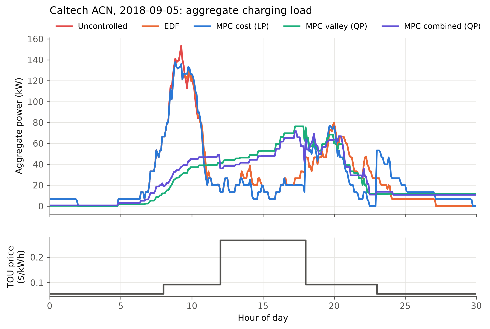
*Figure 1. Aggregate charging load on 5 September 2018 for five schedulers, with the TOU price below.*

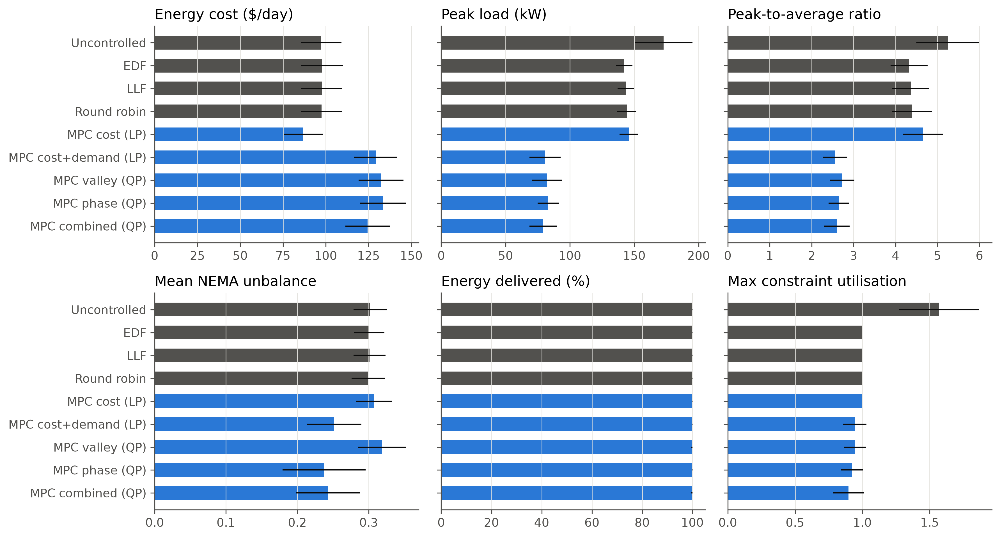
*Figure 2. Mean ± standard deviation over the 19 days. MPC schedulers in blue, baselines in grey.*

**Observations**

- **Uncontrolled charging is infeasible.** On 5 September, for example:
  - the CC Pod carried 128 A against an 80 A rating (1.60×);
  - Secondary B carried 497 A against 417 A;
  - Primary C carried 206 A against 181 A.

  On average 27 five-minute periods per day were over a limit. The simulator still delivered that energy, so uncontrolled charging's cost and energy figures are not achievable on the real site.
- **EDF, LLF and round robin are almost identical.** All three keep the network at exactly its limit (utilisation 1.00), so the binding pod and phase limits set their peak (about 142–144 kW). None of them looks at prices, so their energy cost equals uncontrolled.
- **The cost LP is the cheapest on energy:** −11% vs uncontrolled, −11% vs EDF. It moves charging out of the 12:00–18:00 on-peak window, which costs 0.267 $/kWh, into the 08:00–12:00 mid-peak window. Its peak stays high (146 kW): energy is cheapest when it is concentrated in the cheap periods.
- **Peak-oriented objectives halve the peak** (173 → 79–83 kW, PAR 5.2 → 2.6). The price is $27–36 per day of extra energy cost (vs uncontrolled), because a flat profile has to put load into the on-peak afternoon window.
- **The phase penalty is the only thing that improves balance.** It cuts mean NEMA unbalance from about 0.30 to **0.237** (−21%). Valley filling alone slightly *worsens* balance (0.319): a flat total load does not make the three phases equal.
- **The combined QP** (cost + valley + phase) gets the lowest peak and near-best balance, at $8/day less energy cost than valley or phase alone.
- **Energy delivered is 99.8–99.9% for every method.** The 0.48 kWh/day that even uncontrolled charging misses is physically impossible to deliver: those sessions' recorded kWh does not fit in their 5-min-rounded window at 6.66 kW. The convex schedulers miss a further 0.3–1.1 kWh/day (≤ 0.14%). This is the soft penalty trading a little energy for a lower peak, as weighted.

**Monthly bill.** This is 19 days of energy plus the demand charge on the highest peak of the month:

| Method | Energy ($) | Month's max peak (kW) | Demand charge ($) | **Bill ($)** |
|---|---|---|---|---|
| MPC combined (QP) | 2,364 | 98.5 | 1,528 | **3,892** |
| MPC cost (LP) | 1,652 | 150.1 | 2,328 | 3,980 |
| MPC cost+demand (LP) | 2,454 | 100.4 | 1,557 | 4,011 |
| MPC phase (QP) | 2,535 | 97.3 | 1,509 | 4,044 |
| MPC valley (QP) | 2,515 | 101.2 | 1,570 | 4,084 |
| LLF / round robin / EDF | 1,855–1,859 | 150 | 2,325–2,328 | 4,181–4,184 |
| Uncontrolled | 1,848 | 212.3 | 3,292 | 5,140 |

- **Every convex scheduler beats every heuristic on the bill.**
- **Combined QP vs cost LP:**
  - The combined QP is cheapest overall, but only 2% below the cost LP, because the two terms of the bill pull in opposite directions.
  - The cost LP saves on energy but pays the full transformer-level demand charge.
  - The peak-oriented schedules save about $800 in demand charge but spend about $700 more on energy.
  - The combined objective's main gain is on the grid side: a 34% lower monthly peak than the cost LP, and 21% less unbalance.
- **Uncontrolled charging** would cost $1,250 more than the best schedule, even before counting that it is physically infeasible.

### 7.2 Phase currents

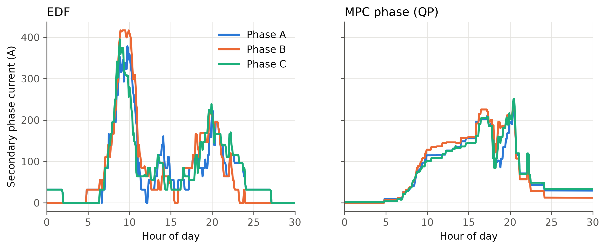
*Figure 3. Secondary phase currents on 5 September 2018: EDF (left) vs MPC phase QP (right).*

- **EDF** charges everyone at once in the morning. Phase B reaches the 417 A secondary limit around 09:00–10:00, while phases A and C stay 30–60 A lower.
- **The phase QP** keeps the three phase currents close together for most of the day. Its highest phase current is about 250 A instead of 417 A, because it spreads the load out. It has no cost term, so much of its load falls in the expensive afternoon window.

### 7.3 E2: Weight sweep and Pareto trade-offs (5 days, $w_c = 1$)

| $w_v$ \ $w_\phi$ | Cost (0) | Peak (0) | Unb. (0) | Cost (1) | Peak (1) | Unb. (1) | Cost (10) | Peak (10) | Unb. (10) |
|---|---|---|---|---|---|---|---|---|---|
| 0 | 90.4 | 146.3 | 0.310 | 95.0 | 144.0 | 0.254 | 102.8 | 141.3 | 0.262 |
| 0.03 | 90.3 | 118.3 | 0.274 | 95.4 | 116.3 | 0.224 | 102.4 | 111.4 | 0.231 |
| 0.1 | 91.1 | 122.5 | 0.277 | 99.1 | 109.1 | **0.209** | 103.5 | 113.4 | 0.230 |
| 0.3 | 114.2 | 83.6 | 0.264 | 115.8 | 88.2 | 0.212 | 120.0 | 92.9 | 0.216 |
| 1 | 128.5 | 83.4 | 0.278 | 128.6 | 82.0 | 0.248 | 132.2 | 88.1 | 0.211 |
| 3 | 133.3 | 83.8 | 0.287 | 133.0 | 82.6 | 0.269 | 134.5 | 85.0 | 0.231 |
| 10 | 135.4 | 83.7 | 0.303 | 135.3 | 83.7 | 0.295 | 135.2 | 83.1 | 0.268 |

*Cost in $/day, peak in kW, Unb. = mean unbalance. The number in brackets is $w_\phi$.*

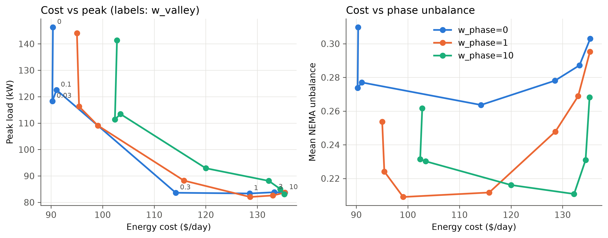
*Figure 4. Left: energy cost vs peak (labels show $w_v$). Right: energy cost vs mean unbalance.*

**Observations**

- **A small valley weight is almost free.** Going from $w_v = 0$ to $0.03$ cuts the peak from 146 to 118 kW (−19%) with no change in energy cost.
  - The reason: the TOU tariff is piecewise constant, so the cost LP has many equally cheap schedules, and a tiny quadratic term picks the flattest of them.
  - **Practical recommendation:** always add a small valley term to a cost objective.
- **There is a clear knee at $w_v \approx 0.3$.** The peak drops to 84 kW for +$24/day. Larger weights add cost (up to $135) with no further reduction in peak.
- **The online peak bottoms out at about 82–84 kW**, whatever the weight. That limit comes from the MPC not knowing future arrivals (E3), not from the weights.
- **A moderate phase weight ($w_\phi = 1$) is enough.** It brings unbalance down to 0.21–0.25 for a few $/day. $w_\phi = 10$ adds cost without further improvement.
- **Very large valley weights undo the balancing.** They make the load flat in time, and that dominates the phase term (unbalance rises back to about 0.30 at $w_v = 10$).

### 7.4 E3: Online MPC vs offline perfect-information optimum (19 days)

| Preset | Energy cost MPC / offline ($/day) | Peak MPC / offline (kW) | PAR MPC / offline | Unbalance MPC / offline | Monthly bill MPC / offline ($) |
|---|---|---|---|---|---|
| cost LP | 86.9 / 87.0 | 145.9 / 145.9 | 4.65 / 4.65 | 0.308 / 0.307 | 3,980 / 3,981 |
| cost+demand LP | 129.2 / 95.6 | 80.7 / 70.6 | 2.55 / 2.25 | 0.252 / 0.279 | 4,011 / 3,321 |
| valley QP | 132.4 / 119.2 | 82.4 / **47.2** | 2.73 / **1.56** | 0.319 / 0.305 | 4,084 / 3,121 |
| phase QP | 133.4 / 122.4 | 83.1 / 57.9 | 2.65 / 1.84 | 0.237 / **0.216** | 4,044 / 3,515 |
| combined QP | 124.4 / 112.6 | 79.2 / 56.7 | 2.60 / 1.85 | 0.243 / 0.232 | 3,892 / 3,170 |

All offline schedules replayed in ACN-Sim with no infeasible periods.

**Observations**

- **The cost LP loses nothing online** ($86.9 vs $87.0; the tiny difference is solver tolerance).
  - Prices are known in advance, and each EV's cheapest periods do not depend on EVs that arrive later.
  - So MPC with perfect knowledge of the connected EVs is already optimal for pure TOU cost.
- **Peak-oriented objectives lose a lot.**
  - Online valley filling reaches 82 kW. With the whole day known it reaches 47 kW, 43% lower.
  - The morning arrival burst (44% of cars arrive 07:00–10:00) is the cause. When the first cars arrive, the MPC does not know that many more are coming. It spreads their charging over the next hours, the later cars then add on top, and the peak builds up.
  - The offline solver knows the whole day and starts the early cars faster, leaving room for later ones.
- **The cost+demand LP gap is mostly cost:** $34/day of energy, but only 10 kW of peak.
  - The online demand term protects the peak, but having no forecast forces late arrivals into the expensive afternoon.
- **The bill gap is $530–960 a month** for the peak-oriented objectives. This is an upper bound on what **arrival forecasting** could be worth here, and it motivates future work on stochastic MPC or forecast-informed MPC.

### 7.5 E4: Soft vs hard energy constraint (19 days)

| Preset | Constraint | Energy delivered | Unmet (kWh/day) | Energy cost ($/day) | Peak (kW) | Hard solves infeasible (per day) |
|---|---|---|---|---|---|---|
| cost LP | soft | 99.906% | 0.760 | 86.95 | 145.87 | – |
| cost LP | hard | 99.906% | 0.760 | 86.95 | 145.87 | 32.1 |
| valley QP | soft | 99.809% | 1.565 | 132.36 | 82.39 | – |
| valley QP | hard | 99.810% | 1.559 | 132.36 | 82.41 | 37.6 |

**Observations**

- **The hard version is infeasible in 32–38 MPC solves per day.**
  - These involve sessions whose recorded energy cannot be delivered in their (5-min-rounded) window at the maximum rate.
  - Real requests are not always physically achievable, so a pure hard constraint would make the controller fail.
- **With the soft fallback, results are the same as the soft model.** The large unmet penalty makes the soft model deliver everything that can be delivered.
- **Recommendation:** use the soft formulation with a large penalty.
  - It is always feasible, and the problem stays convex.
  - When the hard version is feasible, the soft one delivers the same energy, because of the penalty.

### 7.6 E5: Robust extension (50 kW synthetic PV ±40%, $\rho = 0.5$, 5 days)

Net import cost in $/day, using 200 AR(1) PV realisations per run:

| $\Gamma_\text{sol}$ | $\Gamma_\text{pr}$ | At forecast | Mean realised | P95 realised | Worst realised |
|---|---|---|---|---|---|
| 0 | 0 (nominal) | 49.8 | 55.0 | 62.7 | 65.6 |
| 0 | 12 | 53.6 | 55.7 | 65.4 | 68.8 |
| 0.25 | 0 | 51.7 | 54.4 | 60.5 | 63.1 |
| 0.5 | 0 | 53.3 | 54.5 | 58.9 | 61.1 |
| 0.5 | 12 | 49.5 | 51.5 | 58.7 | 61.5 |
| 1.0 | 0 | 55.6 | 55.8 | 58.6 | 60.6 |
| **1.0** | **12** | **49.5** | **50.3** | **54.9** | **57.4** |
| 1.0 | 24 | 50.2 | 51.2 | 55.3 | 57.6 |
| 1.0 | 48 | 53.3 | 53.7 | 56.7 | 58.3 |

The full 4 × 4 grid is in `results/table_robust.csv`.

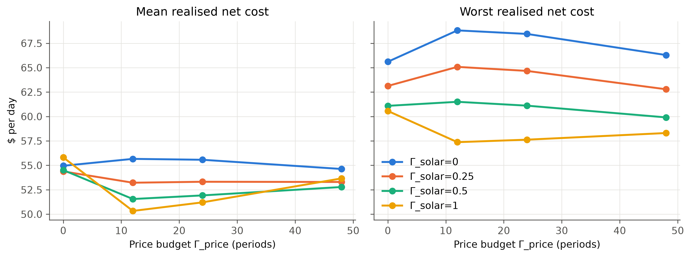
*Figure 5. Mean and worst realised net cost vs price budget, for each solar protection level.*

**Observations**

- **Solar protection works.** $\Gamma_\text{sol}$ from 0 to 1 (at $\Gamma_\text{pr} = 0$) narrows the spread of outcomes:
  - worst case 65.6 → 60.6, P95 62.7 → 58.6;
  - the cost at the forecast rises 49.8 → 55.6.

  This is the textbook **price of robustness**: a more conservative plan that does not fully use the forecast PV.
- **The best setting is $\Gamma_\text{sol} = 1$, $\Gamma_\text{pr} = 12$** (protect against the price rising in 1 hour of 5-min periods). Compared with nominal:
  - worst case −12.5% (65.6 → 57.4);
  - P95 −12.5% (62.7 → 54.9);
  - mean −8.5% (55.0 → 50.3);
  - no loss at the forecast (49.5 vs 49.8).
- **The price budget adds hedging even though realised prices are nominal.** The $\Gamma_\text{pr}\lambda + \sum\mu_t$ term penalises import in the most expensive periods hardest. That pushes the plan to import less during the on-peak window, exactly when a PV shortfall would be most expensive. So the price budget and the solar protection reinforce each other.
- **Why the mean improves too.** Import cost is convex in PV ($\max(P - pv, 0)$). A plan that relies exactly on the forecast PV is penalised by every shortfall but gains nothing from surpluses (Jensen's inequality). Hedging therefore lowers the *expected* cost as well.
- **Too much robustness gives the gain back.** At $\Gamma_\text{pr} = 48$, cost rises again at every percentile. This is the usual "too conservative" end of the Bertsimas–Sim trade-off.
- **Gross peak stays at about 150 kW in the robust runs.** The demand term here applies to net import, so gross load can rise to the transformer limit at midday when PV covers it. A site that wants both should add a valley term or a gross-peak term.
- **Caveat:** the PV profile is synthetic and only 5 days were evaluated. These results show how the method behaves, not what an actual site would save.

### 7.7 E6: Computation

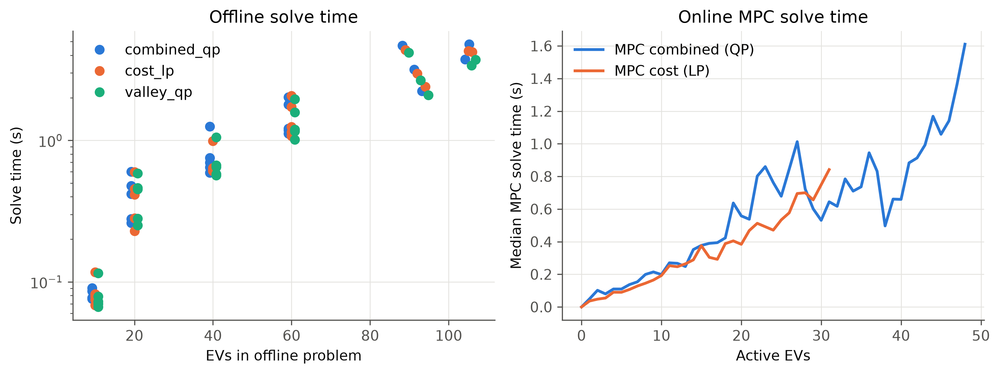
*Figure 6. Left: offline full-day solve time vs number of EVs. Right: median per-call MPC solve time vs number of active EVs.*

**Offline full-day problem** (run sequentially, Clarabel). The full day is about 600 periods × up to 106 EVs, i.e. up to about 63,000 variables and about 4,800 SOC constraints. Mean solve time in seconds:

| EVs | cost LP | valley QP | combined QP |
|---|---|---|---|
| 10 | 0.08 | 0.08 | 0.08 |
| 20 | 0.40 | 0.41 | 0.41 |
| 40 | 0.69 | 0.70 | 0.79 |
| 60 | 1.45 | 1.38 | 1.46 |
| 89–106 (full days) | 2.4–4.4 | 2.1–4.2 | 2.2–4.8 |

**Online MPC per-call solve time** (median, E1, 19 days):

| Active EVs | cost LP | valley QP | combined QP |
|---|---|---|---|
| 1–10 | 0.09 s | 0.06 s | 0.08 s |
| 11–20 | 0.29 s | 0.35 s | 0.36 s |
| 21–30 | 0.57 s | 0.67 s | 0.72 s |
| 31–40 | 1.04 s | 0.65 s | 0.70 s |
| 41–50 | 0.93 s | 0.95 s | 1.08 s |

**Observations**

- **Solve time grows roughly linearly with problem size.**
  - LP and QP cost about the same; the SOC network constraints dominate.
  - About 80% of each MPC call is spent inside the solver; the rest is cvxpy model compilation.
- **The worst single MPC call was 3.5–9.9 s.** That was measured with 14 simulations running in parallel on one machine, so it is inflated by contention.
- **A real-time controller has plenty of margin.** Even the slowest call is about 30 times faster than the 300 s control period.
- **The convex formulation is practical** for a site of this size: a full day of 100+ EVs with exact three-phase limits solves to global optimality in a few seconds.

(These timings use the original formulation, in which $R$ is a dense $n \times T$ variable. Section 8.7 describes a sparse version that solves the same problem about 10× faster.)

---

## 8. v2: Billing-accurate month and arrival forecasting (E7)

### 8.1 Why a second version

E1–E6 price every day on its own. Five simplifications separate that from how the site is actually billed and how its batteries behave:

| v1 simplification | Reality | v2 |
|---|---|---|
| Peak = highest 5-min power of the day | Utilities bill the highest **15-min average** of the month | Rolling 15-min mean $\bar P_t$, in the metrics *and* in the model |
| Each day starts with a zero peak; demand weight $w_d = 1/21$ | Once a peak is set it is paid for the rest of the month; any increase costs the full $15.51/kW | Days simulated in sequence, carrying the month-to-date peak; $w_d = 1$ on **every** MPC preset |
| No notion of a target | A site manager plans to a peak budget | Soft ceiling at a peak target $P^\star$ |
| Energy is due only at departure | Drivers may leave early; late charging is risky | Soft "finish by" deadline 30 min before departure |
| Ideal battery | Charging tapers as the battery fills | ACN `Linear2StageBattery` |

v2 also adds the extension that E3 motivated: an **arrival forecast** on top of the best online model, the combined QP with the demand term. E1–E6 are unchanged and stay reproducible, because every new option defaults to the v1 behaviour.

### 8.2 Model additions

All additions keep the problem an LP/QP with SOC constraints.

**Rolling billed peak.** For window $w = 3$ (15 min):

$$
\bar P_t = \tfrac13\,(P_t + P_{t-1} + P_{t-2}),
$$

where $P_{-1}, P_{-2}$ are the last two *measured* aggregate powers (constants passed in by the MPC). $\bar P$ is affine in $R$.

**Monthly carry and soft ceiling.** Let:

- $M$ = month-to-date billed peak;
- $D$ = today's realised $\max \bar P$ so far;
- $F = \max(P^\star, M, D)$, the demand floor.

The demand and hinge terms are

$$
J_d = d\cdot\max\big(\max_t \bar P_t,\ F\big), \qquad J_h = \Delta \sum_t \big(\bar P_t - F\big)^+ .
$$

- $J_d$ charges only for raising the billed peak above what is already paid for (or planned, through $P^\star$).
- The hinge $J_h$ ($w_h = 1$, in $/kWh) makes *every* period above the ceiling cost something, not just the highest one. This gives the solver a reason to shave all exceedances.
- Both terms are epigraph LPs.
- $P^\star = 54.9$ kW is the 90th percentile of the daily 15-min peaks of the offline optimum (combined + demand, taper) on the 23 August 2018 weekdays.

**Soft finish-by.** Let $\tau_i$ be EV $i$'s departure minus 6 periods, and $E_i^{<\tau}$ the energy it receives before $\tau_i$. Then

$$
E_i^{<\tau} + v_i \ \ge\ e_i - u_i,\qquad v_i \ge 0,\qquad J_f = \textstyle\sum_i v_i ,
$$

with $w_f = 1$ \$/kWh. That is about 4× the on-peak price, so it moves energy earlier when this is cheap to do, but it is 100× below the unmet penalty.

**Tapering battery.** ACN's two-stage battery charges at the pilot until the state of charge reaches $\sigma = 0.8$. Above that its rate falls in proportion to $1 - \text{soc}$. Integrating that stage over one period at full pilot gives an exact *linear* bound on per-period energy $\epsilon_{i,t} = V_iR_{i,t}\Delta/1000$:

$$
\epsilon_{i,t} \le \kappa_i\big(H_i - S_{i,t}\big),\qquad S_{i,t} = \textstyle\sum_{s<t}\epsilon_{i,s},\qquad \kappa_i = 1 - \exp\!\Big(-\frac{m_i\Delta}{c_i(1-\sigma)}\Big),
$$

where $c_i$ is the capacity, $H_i = c_i(1-\text{soc}_{i,0})$ the initial headroom, and $m_i$ the maximum power.

- $S_{i,t}$ is implemented as a per-EV recursion, $S_{i,t+1} = S_{i,t} + \epsilon_{i,t}$, not with `cumsum` (see 8.7).
- A unit test checks the bound against `Linear2StageBattery` to within 1%.
- Only the offline benchmark uses this model, because it needs each car's battery capacity and starting charge.
- The online MPC and the baselines see the taper only through ACN's **`SimpleRampdown`** estimator. It lowers an EV's maximum rate once the EV draws less than its pilot.

**An acnportal bug.** `apply_upper_bound_estimate` looks up the estimator's bounds by `station_id`, but `SimpleRampdown` returns them keyed by `session_id`. The lookup falls back to $+\infty$, so with the stock classes the rampdown estimate is silently never applied. `schedulers.StationRampdown` re-keys the bounds by station. EDF, LLF and round robin use it in E7, and a unit test covers it.

**Arrival forecast: expected "ghost" EVs.** For each future hourly arrival bin $b$ the forecaster uses the previous 28 days of weekday history (no look-ahead; Labor Day excluded). It estimates:

- $\lambda_b$, the mean number of arrivals per weekday;
- the mean energy $\bar k_b$;
- the mean stay $\bar s_b$.

Each bin with $\lambda_b \ge 0.05$ becomes three ghost rows, one per phase group (AB, BC, CA):

- arrival at the bin midpoint;
- upper bound $\lambda_b \cdot 32/3$ A over the expected stay;
- soft energy $\lambda_b \bar k_b/3$.

The ghosts sit on three **virtual EVSE columns**. Each column of $A$ is the mean of its phase group's real columns, so expected cars load the pods, the secondary and the primary in the right proportions. The MPC horizon is extended to cover the ghosts' departures, and only real EVs' rates are applied.

This is a certainty-equivalent forecast: about 40–70 extra rows, and the problem class stays the same. Over September it predicted 88–94 arrivals per day against 81–106 actual. The error in daily arrivals is 5.7% and in daily energy 7.8%, with a −35 kWh/day bias.

### 8.3 Experiment E7

**Setup**

- **Days:** the 19 September weekdays, simulated in order **for each scheduler**, with the month-to-date 15-min peak carried from day to day.
- **Schedulers:**
  - the four baselines (with `StationRampdown`);
  - the five MPC presets (all with $w_d = w_h = w_f = 1$);
  - `mpc:combined_qp+forecast`.
- **Parallelism:** each scheduler's month is one job, and the jobs run in parallel.
- **Offline benchmarks:** each solves **all 19 days jointly** with one shared billed-peak variable, which is the true monthly optimum. The taper model is included, and each day is replayed in ACN-Sim.
  - "Offline bill LP" minimises energy cost + demand charge.
  - "Offline combined" uses the combined weights.

With $w_d = 1$ everywhere, `cost_lp` and `cost_demand_lp` become the same problem; we call it the **bill LP**.

### 8.4 Results

| Scheduler | Energy ($) | Billed peak, 15-min (kW) | 5-min peak (kW) | **Bill ($)** | Bill if billed on 5-min ($) | Energy delivered | ¢ per kWh delivered | Unbalance |
|---|---|---|---|---|---|---|---|---|
| Uncontrolled | 1,874 | 191.6 | 195.8 | 4,845 | 4,910 | 100.09% | 31.5 | 0.295 |
| EDF | 1,883 | 144.0 | 145.9 | 4,116 | 4,147 | 99.92% | 26.8 | 0.294 |
| LLF | 1,880 | 142.9 | 144.8 | 4,096 | 4,126 | 99.92% | 26.7 | 0.294 |
| Round robin | 1,878 | 142.5 | 144.0 | 4,088 | 4,111 | 99.77% | 26.7 | 0.293 |
| MPC bill (LP) | 1,941 | 70.3 | 97.5 | **3,031** | 3,453 | 98.92% | **19.9** | 0.275 |
| MPC valley (QP) | 2,445 | 78.5 | 83.0 | 3,663 | 3,733 | 95.88% | 24.9 | 0.316 |
| MPC phase (QP) | 2,435 | 68.6 | 80.0 | 3,498 | 3,675 | 96.76% | 23.5 | **0.240** |
| MPC combined (QP) | 2,313 | 77.6 | 83.1 | 3,518 | 3,603 | 96.50% | 23.7 | 0.248 |
| **MPC combined + forecast** | 2,109 | 67.4 | 74.6 | 3,155 | 3,266 | 97.38% | 21.1 | 0.247 |
| Offline bill LP (month) | 2,046 | 71.2 | 81.0 | 3,150 | 3,302 | 99.57% | 20.6 | 0.284 |
| Offline combined (month) | 2,203 | **64.0** | **67.0** | 3,196 | 3,242 | 99.59% | 20.9 | 0.251 |

The bill is the energy over 19 weekdays plus $15.51 × the month's highest 15-min peak. Every controlled schedule stayed within the network limits (max utilisation 1.00, no infeasible periods); uncontrolled reached 2.06× a limit. The checks below all passed:

- the month-to-date peak never decreases;
- the daily increments sum to the monthly peak;
- the 15-min peak never exceeds the 5-min peak.

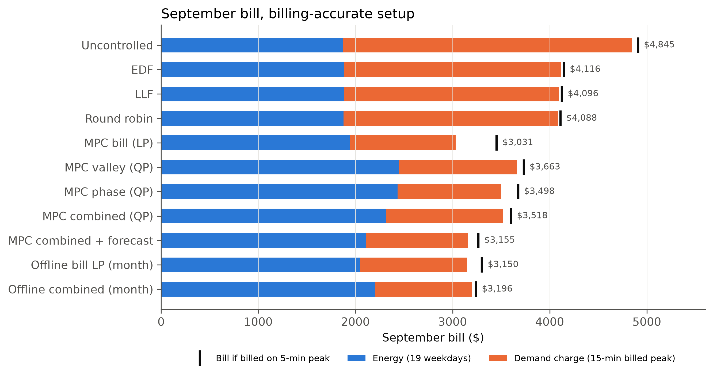
*Figure 7. September bill split into energy and demand charge; the black tick marks the bill under 5-min billing.*

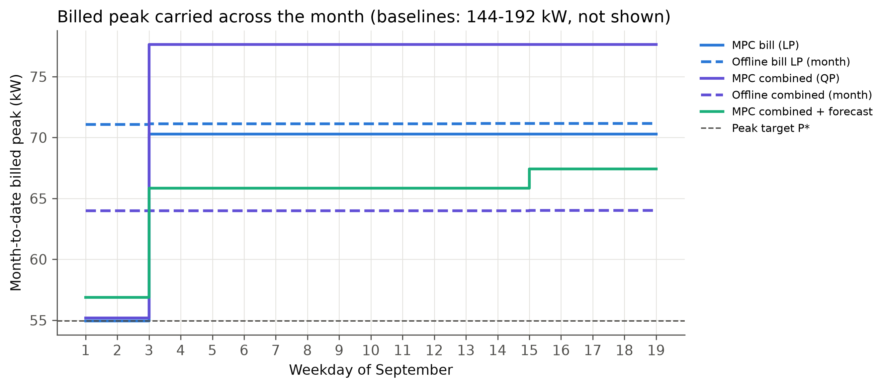
*Figure 8. Month-to-date billed peak over the 19 weekdays. Offline benchmarks are dashed in the colour of their online counterpart.*

**Observations**

- **The bill LP is the cheapest online controller** ($3,031, 19.9¢ per kWh delivered, against $4,088–4,116 for the heuristics).
  - On 4–5 September it held the peak target exactly (54.9 kW).
  - On 6 September, a heavy day (97 sessions, 830 kWh), it had to raise the peak to 70.3 kW.
  - From then on it sits *exactly* on 70.3 kW every day. Peak capacity already paid for is free for the rest of the month, so the LP uses it to buy more energy in cheap periods. The monthly carry produces exactly this behaviour, and a per-day demand term cannot.
- **The peak target only acted early.** The joint offline optimum needs 64.0 kW in September, so August's P90 (54.9 kW) is below what this month allows. After day 3 the floor is the month-to-date peak, and $P^\star$ no longer binds.
- **15-min billing changes the optimal schedule.**
  - The bill LP's highest 5-min power (97.5 kW) is 39% above its billed 15-min peak. It packs short bursts between quieter periods, because only the rolling mean is billed.
  - Billed on 5-min peaks, its bill would be $423 higher.
  - The QPs' valley terms keep 5-min and 15-min peaks close (bill difference $70–180).
  - A site that also cares about transformer stress should keep a small valley term or a 5-min peak term next to the billed-demand term.
- **Peak and phase objectives cost energy, as in v1.** The valley and phase QPs pay $500 more for energy than the bill LP over the month. With tapering batteries they also deliver less energy (Section 8.6).

### 8.5 Value of arrival forecasting

| Combined QP | Billed peak (kW) | Bill ($) | Energy ($) | Delivered | ¢/kWh |
|---|---|---|---|---|---|
| Online, no forecast | 77.6 | 3,518 | 2,313 | 96.50% | 23.7 |
| Online, ghost-EV forecast | **67.4** | **3,155** | **2,109** | **97.38%** | **21.1** |
| Offline (month, perfect information) | 64.0 | 3,196 | 2,203 | 99.59% | 20.9 |

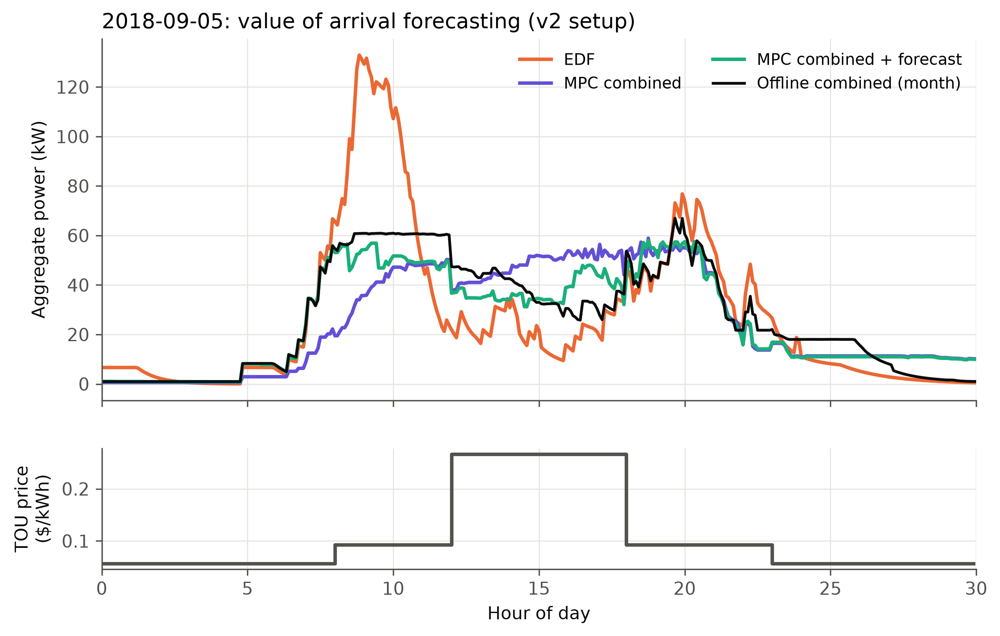
*Figure 9. 5 September: the forecast-informed MPC follows the offline optimum's morning ramp and leaves room for the midday arrivals.*

- **Adding the forecast to the best online model:**
  - billed peak −10.2 kW (−13%);
  - bill −$362 (−10.3%);
  - energy cost −$204;
  - 0.9 percentage points more energy delivered.
- **It closes 75% of the peak gap to the perfect-information optimum** (13.6 → 3.4 kW). Per kWh delivered the bill is within 1% of offline (21.1 vs 20.9¢).
  - The raw bill even falls below the offline one, but only because the online controller delivers 2.2 points less energy.
- **Why it works:** the mechanism is the one E3 pointed to.
  - Without a forecast, the MPC spreads the first morning cars over the whole day. The later arrivals then stack on top (Figure 9, purple).
  - With expected arrivals in the horizon, it charges the early cars faster while the site is empty and keeps headroom for the 07:00–10:00 burst (green), much as the offline optimum does (black).
- **The forecast is simple and cheap.** It is hourly means from four weeks of history, with no weather or calendar features, and it adds about 30% to the per-call solve time.
  - A richer forecaster (day-of-week effects, scenario-based or chance-constrained MPC) could close part of the remaining 3.4 kW.

### 8.6 Tapering batteries

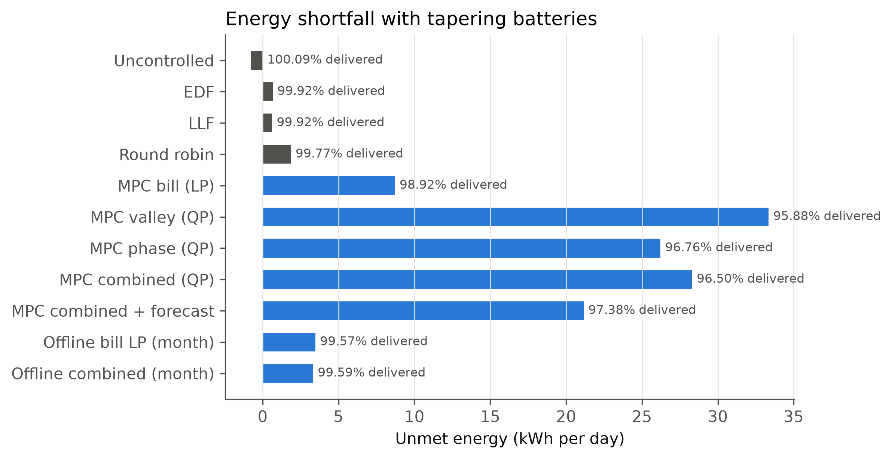
*Figure 10. Unmet energy per day with ACN's two-stage battery.*

- **What happens:**
  - The heuristics charge as early as possible and deliver 99.8–99.9%.
  - The offline optima, which know every battery, deliver 99.6%.
  - The online MPCs lose 1.1% (bill LP) to 4.1% (valley QP).
- **Why:** ACN's `batt_cap_fn` fits, for each session, the *smallest* battery size (from 8/24/40/60/85/100 kWh) and the *highest* initial charge for which charging at full rate over the **whole stay** just delivers the recorded energy. In ACN's own words, this maximises the time the battery behaves non-ideally.
  - For an EV whose battery size is binding, every minute of deferral is lost for good.
  - The online MPC does not know the battery. `SimpleRampdown` reports the taper only after it has begun.
  - The more an objective defers (the valley term most of all), the more energy it loses. Forecasting reduces the loss (28.3 → 21.2 kWh/day) because it starts early cars sooner.
  - This is a pessimistic battery fit, not a typical one, but it is ACN's default for data-driven batteries.
- **Raw bills are confounded by delivered energy.**
  - The offline bill LP's bill ($3,150) is *above* the online bill LP's ($3,031) because it delivers 100 kWh more. The extra is the inflexible energy that forces a slightly higher peak.
  - On its own objective (bill + $100 per unmet kWh) it is far better: $9,765 vs $19,605.
  - For this reason the tables also report ¢ per kWh delivered.
- **The offline optima still miss 0.4% in replay.** The linear taper bound is exact at full pilot. At a partial pilot, ACN's taper stage delivers less than the pilot, because its transition point moves with the pilot.

### 8.7 Computation

- **Sparse rate variables.** In v1, $R$ was a dense $n \times T$ variable with $R_{i,t} \le 0$ outside each EV's window, and about 85% of the entries were fixed at zero. v2 creates variables only inside the windows and lifts them into $R$ with a sparse 0/1 matrix.
  - The optimisation problem is identical: the one-day check reproduced every metric.
  - A full offline day solves in 0.9 s instead of 11 s.
- **Taper constraint.** Written with `cumsum` over the full horizon, the taper constraint produces a dense triangular block, and Clarabel's factorisation stalled for more than 15 minutes. The per-EV recursion over the window only solves the same day in 43 s.
- **MPC per call** (10 month-jobs in parallel, 2 solver threads each):
  - median 0.05–0.11 s, P99 2.0–2.9 s, worst 6.2 s;
  - a simulated day takes 88 s (bill LP) to 172 s (forecast).
- **Joint monthly offline problem** (19 days in one problem, taper included): 17 min for the combined QP and 10 min for the bill LP, with 8 threads.

---

## 9. v3: Imperfect information (E8)

### 9.1 Why

Up to E7, every online scheduler read each EV's **true** departure time and energy at plug-in. ACN-Sim's `SessionInfo` carries both, and `estimated_departure` defaults to the true departure. The heuristics use this too: EDF sorts by departure, LLF by laxity, and round robin stops at the requested energy. No real controller knows either value. ACN-Data does record drivers' own estimates (`userInputs`: `kWhRequested`, `minutesAvailable`), but only through the live API (which needs a token). The static snapshot used here has no session records and no user IDs. So E8 gives the controller **predictions from history**, while the simulator keeps the true values: batteries, departures and the unmet-energy metric are unchanged.

### 9.2 Predictor and update rule

For target day $d$, take the weekday sessions of the 28 days before $d$ (the forecaster's window, Section 8.2). Bin them by arrival hour $b$. If a bin has fewer than 10 sessions, widen it to $b\pm1, b\pm2,\dots$. With $Q_q$ the empirical $q$-quantile of the bin's samples, an EV arriving at $a$ gets at plug-in

$$\hat\tau = Q_{q_\tau}(\text{stay}), \qquad \hat e = Q_{q_e}(\text{kWh}).$$

Each period the prediction is updated with what has been observed since:

- **overstay**, when the EV is still plugged in at $t \ge a+\hat\tau$:
  $$\hat\tau \leftarrow Q_{q_\tau}(\text{stay} \mid \text{stay} > t-a)$$
  or $t-a+30$ min if no historical stay is that long;
- **larger request**, when the predicted energy has been delivered (to within 0.05 kWh) and the EV is still charging:
  $$\hat e \leftarrow Q_{q_e}(\text{kWh} \mid \text{kWh} > \text{delivered})$$
  with a step of at least 0.5 kWh.

ACN-Sim removes an EV from the active list once its true request is met, much as a real charger reports that the car has stopped accepting charge. So "still in the list" is the only signal that the car wants more. It never reveals how much.

| Information level | Stay | Energy | Updates |
|---|---|---|---|
| **perfect** (E7) | true | true | — |
| **predicted** | bin median | bin median | conditional, as above |
| **conservative** | bin P25 (assume an early departure) | bin P75 (assume a large need) | conditional, same quantiles |
| **naive** | global median, all sessions pooled | global median | none: an EV past its guess is no longer charged |

### 9.3 Information layer and experiment E8

`EstimatedInterface` (in `estimates.py`) subclasses ACN-Sim's `Interface` and is passed to the simulator as `interface_type`. Its `active_sessions()` returns sessions in which `departure = estimated_departure = arrival + τ̂` and `requested_energy = ê`; the arrival and the delivered energy are the true values. Everything that reads sessions through the interface then sees the predictions, without code changes:

- EDF, LLF and round robin;
- the rampdown estimators;
- `remaining_amp_periods`;
- `ConvexMPC`, whose horizon, windows, finish-by deadlines and energy targets all come from the predictions.

E8 reruns the E7 month (same billing, taper batteries, peak target, finish-by and forecast) for the 8 informed schedulers at the 3 imperfect information levels: 24 month-jobs. Uncontrolled charging ignores departure and energy, so its E7 row stands for every level. The offline benchmarks stay perfect-information.

### 9.4 Prediction quality

| Level | Stay MAE | Stay bias | EVs leaving later than predicted | kWh MAE | kWh bias | EVs needing more than predicted | Day's kWh, predicted / true |
|---|---|---|---|---|---|---|---|
| predicted | 2.6 h | −0.2 h | 49% | 4.5 | −0.95 | 51% | 0.90 (0.71–1.04) |
| conservative | 3.2 h | −2.4 h | 73% | 5.5 | +3.99 | 26% | 1.47 (1.17–1.68) |
| naive | 3.5 h | −0.9 h | 50% | 4.5 | −1.12 | 51% | 0.88 (0.71–1.00) |

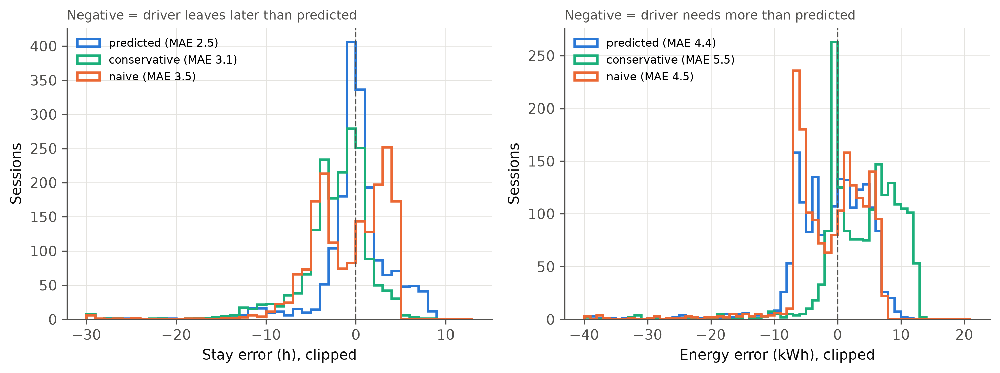
*Figure 11. Plug-in prediction errors for all 1,772 September sessions.*

- **Arrival time predicts the stay well, but not the energy.** Binning by arrival hour cuts the stay error from 3.5 h to 2.6 h. The kWh error barely changes (4.5 kWh either way): how much a car needs hardly depends on when it arrives.
- **Medians undercount totals.** Energy per session is right-skewed (September: median 7.8 kWh, mean 8.7 kWh, 95th percentile 14 kWh, maximum 69 kWh). So the sum of per-session medians is 10% below a day's true energy on average, and 29% below on the worst day. A per-session median can look unbiased and still hide a shortfall at site level.

### 9.5 Results

| Scheduler | Perfect (E7) | Predicted | Conservative | Naive |
|---|---|---|---|---|
| EDF | $4,116 · 144.0 kW · 99.9% | $4,059 · 140.6 · 99.7% | $4,059 · 140.3 · 99.9% | $3,505 · 145.0 · 67.4% |
| LLF | $4,096 · 142.9 · 99.9% | $4,037 · 139.1 · 99.6% | $4,138 · 145.5 · 99.8% | $3,453 · 141.7 · 67.4% |
| Round robin | $4,088 · 142.5 · 99.8% | $4,086 · 142.4 · 99.7% | $4,092 · 142.5 · 99.8% | $3,495 · 144.4 · 67.4% |
| MPC bill (LP) | **$3,031** · 70.3 · 98.9% | $2,924 · 54.9 · 92.3% | **$3,261** · 79.7 · 97.9% | $1,871 · 54.9 · 58.8% |
| MPC valley (QP) | $3,663 · 78.5 · 95.9% | $2,844 · 62.5 · 74.6% | $3,514 · 90.9 · 93.8% | $2,047 · 58.5 · 52.2% |
| MPC phase (QP) | $3,498 · 68.6 · 96.8% | $2,855 · 60.5 · 76.3% | $3,479 · 89.1 · 94.7% | $2,116 · 58.2 · 55.1% |
| MPC combined (QP) | $3,518 · 77.6 · 96.5% | $2,782 · 62.1 · 76.4% | $3,470 · 89.9 · 94.3% | $1,997 · 57.7 · 52.9% |
| MPC combined + forecast | $3,155 · 67.4 · 97.4% | $2,688 · 61.3 · 80.6% | $3,312 · 82.0 · 94.9% | $2,117 · 57.5 · 60.4% |

Each cell gives the September bill, the billed 15-min peak and the energy delivered. Uncontrolled charging ($4,845, 191.6 kW, 100.1%) and the offline optima (bill LP $3,150, combined $3,196) are unchanged from Section 8.4. Every schedule stayed within the network limits, and the month checks passed.

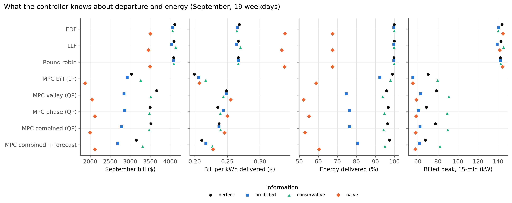
*Figure 12. Bill, bill per kWh delivered, energy delivered and billed peak per scheduler and information level.*

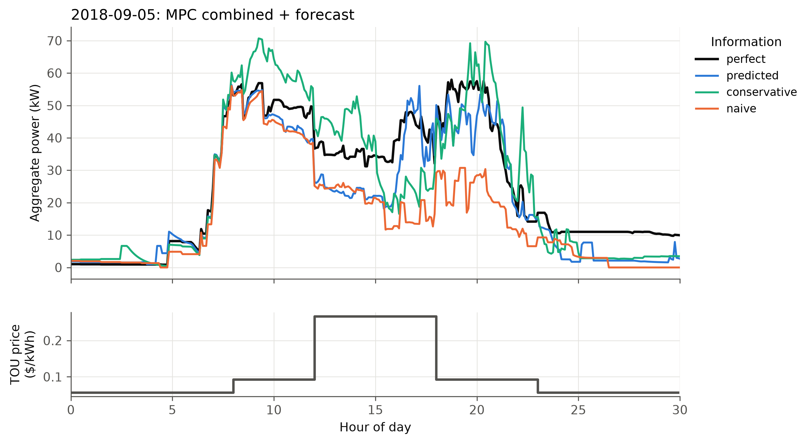
*Figure 13. 5 September: MPC combined + forecast under each information level.*

**Observations**

- **The greedy heuristics are almost insensitive.** EDF, LLF and round robin stay within 0.3 points of energy and ±$60 of their E7 bills.
  - They charge every car as soon as capacity allows, so the predictions only change the *order* of service.
  - The conditional updates keep each car charging until it is really full or gone.
- **Updates matter more than accuracy.** The naive level is no less accurate than the predicted one on energy, yet without updates every scheduler delivers only 52–67%. Cars stop at the global median (about 7 kWh) or at their guessed departure.
  - The naive bills look cheap only because a third of the energy is missing. Per kWh delivered the heuristics become the most expensive (33–34¢).
- **The convex MPCs are the sensitive ones.** With medians they deliver 74–81% (QPs) and 92% (bill LP).
  - They see 10–29% less energy than the site really needs, so they hold the peak near $P^\star$ (55–62 kW) and defer charging (Figure 13, blue).
  - The larger requests are discovered only after the predicted amount has been delivered. By then the car may be leaving, or, with `batt_cap_fn` batteries (Section 8.6), already in its taper.
  - Their bills fall, but bill per kWh barely changes: they are simply buying less energy.
- **Conservative predictions recover most of the energy, at the cost of a higher peak.**
  - Assuming an early departure (P25) and a large need (P75), the MPCs deliver 94–98%. They charge earlier and harder, and billed peaks rise to 80–91 kW (Figure 13, green).
  - The bill LP pays $3,261: +$231 (+7.6%) and −1.0 point of energy against perfect information, or 21.7¢ against 19.9¢ per kWh.
- **The convex MPC still wins.** Under realistic (conservative) information, the bill LP is 20% cheaper than the best heuristic under the same information (EDF predicted, $4,059), and 18% cheaper per kWh, though it delivers 1.8 points less energy.
  - The arrival forecast still pays: combined + forecast is $158 cheaper than combined, with an 8 kW lower peak.
- **The value of perfect user information** for the best online controller is about $230 a month (8%) plus about 1% of the energy. That is the most that better user input could recover, for example drivers' own estimates (ACN-Data `userInputs`) or a richer predictor.

### 9.6 Computation and an implementation note

- **Speed.** With 24 month-jobs on 12 workers (1 solver thread each), the per-call median is 0.02–0.03 s, P99 0.6–0.7 s and the worst call 2.1 s. A simulated MPC day takes 14–83 s. Predicted horizons are shorter than the true ones, so solves are faster than in E7.
- **Round-robin pilot steps.** Round robin allocates pilots in 0.1 A steps, so it cannot deliver a residual below one step. In a first run, its sessions stopped a few watt-hours short of each predicted request, so the energy re-prediction never fired (81.8% delivered). "Request met" now carries a 0.05 kWh tolerance, a unit test covers this case, and all 24 jobs were rerun.
- **Memory.** Each worker process committed about 3 GB for OpenBLAS thread buffers, and 27 parallel processes ran out of memory. The driver now sets `OPENBLAS_NUM_THREADS=1`.

---

## 10. v4: On-site solar (E9)

### 10.1 Why

E5 tested PV only for the robust cost LP, on 5 separate days, with the same clear-sky curve as the forecast every day and no monthly bill. Workplace sites increasingly have rooftop or carport PV behind the same meter as the chargers, and then what matters is **net grid import**: its energy cost and its billed peak. E9 adds a 50 kW array to the billing-accurate E7 month and reruns every MPC. The heuristics are not rerun, since they ignore PV and their schedules would not change.

### 10.2 Synthetic weather and PV forecast

For each calendar date $d$, a random generator seeded by the date draws a sky type and a daily clearness $k_d$, so every scheduler and information level sees the same sky:

| Sky | Probability | $k_d$ | Cloud amplitude $a$ |
|---|---|---|---|
| clear | 70% | U(0.90, 1.00) | 0.03 |
| partly cloudy | 20% | U(0.55, 0.85) | 0.25 |
| overcast | 10% | U(0.20, 0.45) | 0.08 |

With $\bar{pv}_t$ the clear-sky curve, the realised PV is

$$pv_t = \bar{pv}_t\,\mathrm{clip}(k_d + a z_t,\ 0,\ 1.05), \qquad z_t = 0.9\,z_{t-1} + \sqrt{1-0.9^2}\,\varepsilon_t \quad\text{(AR(1) passing clouds)}.$$

The controller gets a day-ahead clearness $\hat k_d = \mathrm{clip}(k_d + \mathcal N(0, 0.12^2),\ 0.15,\ 1)$. At period $t$ it blends this with the clearness measured in the last period, $c_{t-1} = pv_{t-1}/\bar{pv}_{t-1}$, and the blend decays back to the day-ahead value with a 2 h time constant (a persistence nowcast):

$$\hat{pv}_{t+h\mid t} = \bar{pv}_{t+h}\left(\hat k_d + (c_{t-1} - \hat k_d)\,e^{-h/24}\right).$$

The 19 simulated weekdays drew 12 clear and 7 partly cloudy days; September as a whole drew no overcast day (Figure 14). PV averaged 324 kWh per weekday, about 40% of the roughly 800 kWh of EV energy. The day-ahead forecast averaged 305 kWh, with a daily absolute error of 33 kWh. Measured during daylight on the simulated days, the nowcast's mean absolute error is 1.1 kW for the next period, 2.6 kW at 30 min, 3.1 kW at 1 h and 3.4 kW at 2 h. The day-ahead forecast alone errs by about 4.1 kW.

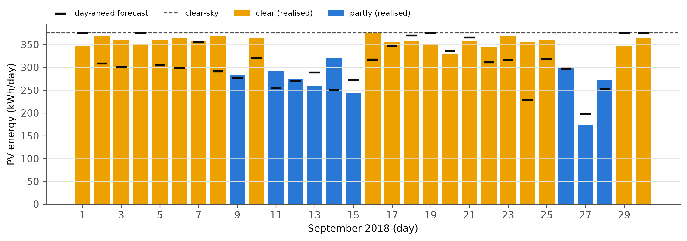
*Figure 14. Daily PV energy in September (realised, by sky type) and the day-ahead forecast.*

Each simulated day uses only its own calendar day's sun. Days are simulated separately, and EVs staying overnight run into the next day's window (Section 12). Giving them the next day's PV would use that sun twice: in a first smoke test, 11 September's simulation counted 531 kWh of PV, against about 290 kWh for the day itself.

### 10.3 Formulation with PV

The robust extension already had the right structure (Section 4.5), with $\Gamma_\text{sol} = 0$ and $\delta_t = 0$. Net import $S_t \ge P_t - \hat{pv}_t$, $S_t \ge 0$, replaces $P_t$ in:

- the energy cost $\sum_t p_t S_t\Delta$, so PV surplus earns nothing;
- the 15-min billed peak $\bar S_t = (S_t + S_{t-1} + S_{t-2})/3$ and its month-to-date floor;
- the peak-target hinge on $P^\star = 54.9$ kW.

The valley term now flattens the **net load**, $\Delta\sum_t (P_t - \hat{pv}_t)^2/P_\text{ref}$. This pulls charging into the sunny hours instead of flattening gross load against the sun. The phase term is unchanged, because PV is assumed to be a balanced three-phase inverter. `ConvexMPC` carries the realised net-import history, $\max(P - pv, 0)$ over the last two periods and today's billed peak so far, into the rolling billed peak. The month-to-date floor carried between days is the import peak. The network constraints still act on the gross currents, so the transformer limit holds as before (utilisation ≤ 1.000 in every run).

The offline benchmark solves the whole month jointly with the realised PV of every day (perfect foresight).

### 10.4 Experiment E9

The setup is the E7 month: taper batteries, finish-by, $P^\star$, a 12 h horizon and the arrival forecast for `+forecast`. It runs for 5 MPCs (bill LP, valley, phase, combined, and combined + forecast) at two information levels: perfect (E7) and predicted (E8 medians, with conditional updates). That makes 10 month-jobs, plus the joint offline months for the bill LP and combined objectives. The comparison is the same scheduler without PV: E7 for perfect information, E8 for predicted.

### 10.5 Results

**Perfect information**

| Scheduler | No PV (E7) | 50 kW PV (E9) | Bill change |
|---|---|---|---|
| MPC bill (LP) | $3,031 · 70.3 kW · 98.9% | $2,514 · **97.2** · 98.6% | −17% |
| MPC valley (QP) | $3,663 · 78.5 · 95.9% | $2,332 · 66.6 · 96.2% | −36% |
| MPC phase (QP) | $3,498 · 68.6 · 96.8% | $2,300 · 64.1 · 97.2% | −34% |
| MPC combined (QP) | $3,518 · 77.6 · 96.5% | $2,235 · 66.0 · 96.7% | −36% |
| MPC combined + forecast | $3,155 · 67.4 · 97.4% | **$1,852** · **54.9** · 98.3% | −41% |
| Offline bill LP (known PV) | $3,150 · 71.2 · 99.6% | **$1,675** · 55.1 · 99.6% | −47% |
| Offline combined (known PV) | $3,196 · 64.0 · 99.6% | $1,863 · 54.1 · 99.6% | −42% |

**Predicted information**

| Scheduler | No PV (E8) | 50 kW PV (E9) | Bill change |
|---|---|---|---|
| MPC bill (LP) | $2,924 · 54.9 kW · 92.3% | $2,235 · 87.0 · 84.3% | −24% |
| MPC valley (QP) | $2,844 · 62.5 · 74.6% | $1,648 · 54.9 · 74.7% | −42% |
| MPC phase (QP) | $2,855 · 60.5 · 76.3% | $1,694 · 54.9 · 76.6% | −41% |
| MPC combined (QP) | $2,782 · 62.1 · 76.4% | $1,629 · 54.9 · 75.8% | −41% |
| MPC combined + forecast | $2,688 · 61.3 · 80.6% | $1,624 · 54.8 · 83.8% | −40% |

Each cell gives the September bill, the billed 15-min peak and the energy delivered. With PV, the bill is the import cost plus the demand charge on the 15-min **import** peak. Every schedule stayed within the network limits (utilisation 1.000, no infeasible periods). The month checks passed: a non-decreasing month-to-date import peak, and daily increments that sum to the billed peak. Full table: `results/table_solar.csv`.

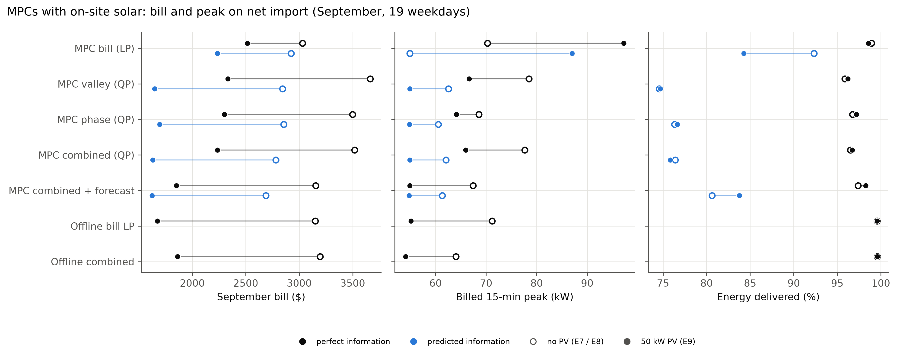
*Figure 15. Bill, billed peak and energy delivered without PV (hollow) and with 50 kW PV (filled), for each MPC and information level.*

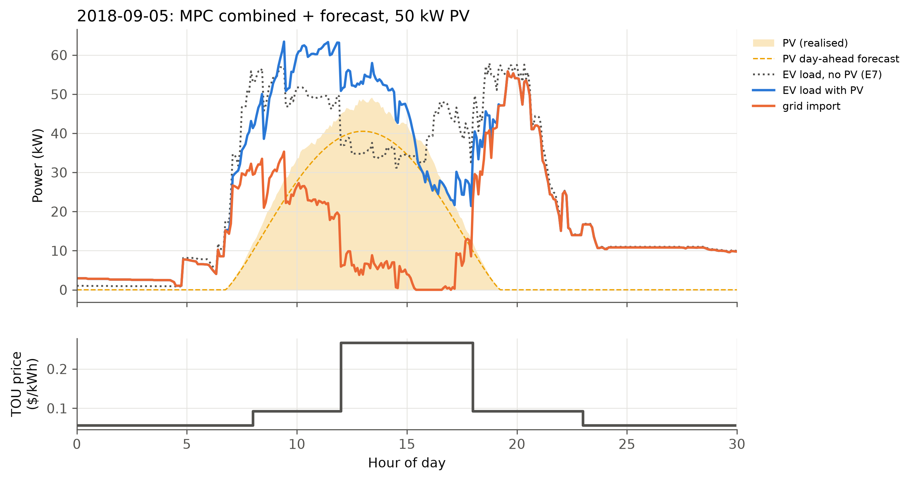
*Figure 16. 5 September (clear day): combined + forecast with PV. Charging moves into the sunny hours and grid import falls to almost zero between 12:00 and 17:00, the on-peak window.*

**Observations**

- **Almost all of the PV is used by every MPC.** Self-consumption is 98–99% (93–97% with predicted information), and PV covers 40% of the EV energy (45–51% with predicted information, which delivers less energy). A 50 kW array rarely exceeds the midday EV load, so the scheduler matters less for *using* the PV than for *when* the rest is imported.
- **The solar-aware QPs gain the most: −34% to −41%.**
  - The net-load valley term moves charging under the PV curve (Figure 16), which is also the on-peak 12:00–18:00 window, so each PV kWh displaces 26.7¢ of import.
  - The import peak drops 4–13 kW below the E7 gross peak.
  - Combined + forecast holds the import peak at $P^\star$ (54.9 kW) all month. Its bill of $1,852 is within 11% of the offline bill LP's $1,675, and below the offline combined optimum ($1,863), whose objective also pays for valley and phase terms.
  - Gross peaks rise (combined + forecast: 67 → 81 kW). The EVs now take PV power on top of the grid's share, but that peak is not billed and stays far inside the transformer limit.
- **The bill LP gains least (−17%), because forecast errors ratchet its billed peak.**
  - Without PV, the bill LP's E7 floor stayed at 70.3 kW all month. With PV, its import peak creeps up nearly every day: 55.8 → 62.1 kW over the first week, then 97.2 kW by 28 September.
  - The LP treats import below the month-to-date floor as free and fills it exactly: in E7 its gross peak equals the floor on most days. With PV, it plans import at the floor *net of the forecast PV*. Whenever realised PV falls short of the forecast during a planned period, realised import exceeds the floor, and the excess becomes the new floor.
  - 34 of the 41 kW of increments came on the 7 partly cloudy days. The ratchet costs about (97.2 − 55.1) × $15.51 ≈ $650 against the offline bill LP, which knows the PV. With PV the bill LP ends up the **most expensive** online MPC: its demand charge ($1,508) is 77% higher than combined + forecast's ($852), while their energy costs are almost equal ($1,006 against $1,001).
  - The QPs are protected by their valley term. It spreads import below the floor instead of packing it at the floor, which leaves headroom for PV errors.
- **Predicted information.** The pattern is the same: the QPs gain 40–42% and hold the import peak at $P^\star$, while their delivery stays at E8 levels (75–84%). The bill LP's delivery falls further, from 92.3% to 84.3%. PV makes midday energy cheaper, so it defers more charging into the solar hours, and cars that leave before their median-predicted departure miss it.
- **What a fix would look like.** A safety margin below the billed floor, or the robust PV protection $\Gamma_\text{sol}$ of Section 4.5, would trade a little PV energy for protection against shortfalls, as E5 showed for the daily cost. E9 runs the nominal certainty-equivalent controller only.

### 10.6 Computation

The 12 jobs ran in one pool of 12 workers with 1 solver thread each, in about 25 min of wall time. Per-call MPC solve times: median 0.03–0.06 s, P99 0.4–1.1 s, worst call 2.0 s. A simulated MPC day took 31–79 s. The joint offline months with PV took 13 min (bill LP) and 15 min (combined) on one thread each. The extra variables ($S_t$, and the net-load valley) do not change the problem class: LP for the bill objective, SOCP-constrained QP for the others.

---

## 11. Discussion: summary of findings

1. **Network limits must be in the model.** ACN-Sim does not stop overloads, and greedy uncontrolled charging exceeds the pod, secondary and primary ratings every day (up to 1.57×). Every convex schedule stayed feasible thanks to the exact phasor SOC constraints.
2. **There is no single best objective; each one wins its own metric.**
   - Cost LP → lowest energy cost.
   - Valley or demand → lowest peak and PAR.
   - Phase QP → lowest unbalance.
   - The combined QP is the best compromise, and it has the lowest monthly bill.
3. **The demand charge changes the picture.** On energy alone, the cost LP is far cheaper. Once the $15.51/kW demand charge is included, peak-aware scheduling earns back its extra energy cost.
4. **A small valley term is free.** Because the tariff is flat within each block, it removes about 20% of the peak at no energy cost.
5. **Balancing the phases needs its own term.** A flat total load can still have unbalanced phases. The negative-sequence penalty fixes this at modest cost.
6. **Online operation costs nothing for price-based objectives but a lot for peak-based ones.** The 47 vs 82 kW gap shows that arrival forecasting is the most valuable addition for peak reduction.
7. **Robust optimisation pays off under convex uncertainty.** Hedging against PV shortfall and price spikes improves the worst case by 12.5%, and even the mean, because import cost is convex in solar output.
8. **The problems solve fast.** Every formulation solves in seconds, so the approach suits real-time control.
9. **Billing details change the optimal schedule (E7).**
   - With the peak carried across the month, a peak that is already paid for is free capacity, and the bill LP uses it fully.
   - With a 15-min billed peak, a bill-only objective packs 5-minute bursts 39% above the billed peak. A valley term keeps them in check.
10. **Forecasting closes most of the online gap.** Expected "ghost" EVs from four weeks of history cut the combined MPC's billed peak by 13% and its bill by 10%, closing 75% of the peak gap to the offline optimum, with no change in problem class.
11. **Battery tapering penalises deferral.** With ACN's pessimistic battery fit, online MPCs that defer charging lose 1–4% of energy, while the greedy heuristics lose almost none. A scheduler that shifts load needs a battery-state model, or at least a taper-aware bound.
12. **Without perfect user information, flexibility has to be estimated (E8).** Greedy heuristics hardly notice predicted departures and energies. The deferring MPCs do: median predictions undercount a day's energy, so they under-deliver (74–92%). Predicting conservatively (early departure, large need) restores 94–98% delivery at about 8% higher bills. The bill LP then still beats the best heuristic by 20%.
13. **Updates beat accuracy.** Re-predicting as soon as a car overstays or keeps charging is what keeps every scheduler whole. A predictor no less accurate but without updates loses a third of the energy.
14. **On-site solar rewards the right objective (E9).** With a net-import bill, a valley term on net load moves charging under the PV curve, and the QPs cut their bills by 34–41%. Combined + forecast holds the import peak at the 54.9 kW target and comes within 11% of the perfect-foresight optimum.
15. **Certainty-equivalent bill minimisation is fragile under PV uncertainty.** The bill LP fills paid-for import capacity exactly to the billed floor, so PV shortfalls keep raising the billed peak (56 → 97 kW over the month). A small valley term or an explicit margin gives the headroom it lacks.

## 12. Limitations and assumptions

- **Continuous pilots.** The real Caltech chargers accept only discrete current levels. We used continuous 0–32 A pilots (`basic_evse`) to keep the problem convex. Rounding to discrete levels afterwards would slightly change cost and peak.
- **User information.** Each EV's true energy request and departure are taken from the data (the delivered kWh and the actual unplug time). E1–E7 give these true values to the schedulers. E8 replaces them with predictions from history, because the static snapshot has no drivers' own estimates (`userInputs`). Real driver estimates, or a predictor with more features (user, weekday, vehicle), would sit between E8's predicted and perfect levels.
- **"Still charging" signal (E8).** ACN-Sim drops an EV once its true request is met, so the controller learns that a car wants more, though not how much, while it is still in the active list. A real charger reports the car's state similarly, but with some delay and noise.
- **Synthetic EVSE assignment.** Phase results depend on our "least-loaded phase" rule, not on where cars actually parked.
- **Per-day demand charge (E1–E6).** The daily `demand_charge` metric applies the full monthly rate to each day's peak. The monthly bill tables use the correct monthly peak. E7 also models the month correctly: a 15-min billed peak carried across days.
- **Independent days (E7).** Days are simulated one after another, but separately. A session that runs past midnight does not add to the next morning's load.
- **Synthetic solar.**
  - In E5, PV is a clear-sky curve with ±40% AR(1) noise. Realised costs in E5 use nominal prices, so the price budget is tested only as a hedge, not against sampled price spikes.
  - In E9, weather is synthetic: sky-type probabilities typical of a Pasadena September, one seed, and no overcast day drawn. A cloudier month, or measured irradiance, would increase forecast errors and the bill LP's ratchet.
  - In E9, PV surplus earns nothing, and the array feeds only the EV load: no building load, no export.
  - In E9, each simulated day gets only its own sun, so cars that stay overnight do not see the next morning's PV.
- **Battery model.** E1–E6 use the ideal battery. E7 uses ACN's two-stage battery as fitted by `batt_cap_fn`. That fit is the most non-ideal battery consistent with each session's recorded energy, so E7's energy shortfalls for the deferring schedulers are a pessimistic case. The online MPC sees the taper only through `SimpleRampdown`.
- **Simple forecast.** Ghost EVs are a certainty-equivalent expectation (hourly means over 4 weeks). The MPC does not plan for the forecast being wrong, beyond re-solving every 5 minutes.
- **Scope.** One site, one month (September is a summer TOU month, with the expensive 12:00–18:00 window). Results for winter prices, or for sites with different arrival patterns, could differ.

## 13. Conclusions

- **A convex formulation is effective and practical.** Charging currents are the decision variables, network limits are exact SOC constraints, and the objectives are linear or quadratic. On a month of real data from the Caltech garage, it:
  - keeps every schedule within the real network limits, which uncontrolled charging violates daily;
  - cuts energy cost by 11% with the cost LP, or halves the peak with valley, demand or combined objectives;
  - cuts phase unbalance by about 21% with the negative-sequence penalty;
  - gives the lowest monthly bill with the combined objective ($3,892, against $4,180 for the best heuristic and $5,140 uncontrolled);
  - with a robust extension, cuts worst-case net cost by 12.5% under solar uncertainty, without hurting the expected cost.
- **Under billing-accurate conditions (E7)** the convex MPC still wins clearly:
  - the bill LP cuts the September bill to $3,031 (−26% against the best heuristic, −37% against uncontrolled);
  - adding an arrival forecast to the combined model cuts its bill by 10% and closes 75% of its peak gap to the perfect-information optimum.
- **With predicted rather than true departures and energies (E8)**, conservative predictions keep the convex MPC ahead: the bill LP's September bill is $3,261 at 97.9% delivered, 20% below the best heuristic under the same information. Perfect user information would be worth about $230 a month on top. Median predictions are a trap for deferring controllers, because they undercount each day's energy.
- **With 50 kW of on-site solar (E9)**, solar-aware MPCs that flatten net load cut the September bill by 34–41%. Combined + forecast reaches $1,852, within 11% of the optimum with known PV. The pure bill LP gains only 17%, because PV forecast errors keep raising its billed import peak.
- **All problems solve to global optimality** in at most a few seconds, fast enough for a 5-minute receding-horizon controller.
- **Information is the main lever.** E3 showed that knowing future arrivals is worth about 40% of the peak. A simple historical forecast recovers most of that.
  - The next gaps are battery state (with tapering batteries, deferral without a battery model costs 1–4% of energy) and user information (about 8% of the bill when departures and energies must be predicted).

## 14. Future work

- **Better forecasts and stochastic MPC.** Build on the ghost-EV forecast (Section 8.5):
  - add day-of-week and calendar effects;
  - plan over arrival scenarios, or with chance constraints on the peak, to close the remaining 3.4 kW.
- **Taper-aware online control.** Estimate each EV's taper from its observed rate response (for example, the per-period decay once it ramps down) and add the linear bound of Section 8.2 to the MPC. This would recover the 1–4% energy lost to deferral.
- **Discrete pilots.** Round the convex solution and compare with mixed-integer formulations, to measure the cost of the continuous relaxation.
- **Better user information.** Fetch the drivers' own estimates (`userInputs`) and user IDs from the ACN-Data API (needs a token), with per-user history as the fallback. Plan with the full predictive distribution (chance-constrained or scenario energy targets) instead of a single quantile. E8 shows that a single conservative quantile already recovers most of the loss.
- **Robust billed peak under PV uncertainty.** Add a margin below the month-to-date floor, or apply $\Gamma_\text{sol}$ only to the billed-peak constraint, to stop the bill LP's ratchet in E9 at a small energy cost.
- **Real PV and price data**, and a second site (JPL), to test whether the results generalise. Also add building load and export tariffs, so that PV surplus has a value.
- **Distributed or first-order solvers** (ADMM) for much larger sites.

---

## Appendix A: Reproducing the results

The code is in `project/`: a Python package `evsched`, scripts and a notebook. Setup:

```bash
uv venv --python 3.11 .venv
uv pip install --python .venv/Scripts/python.exe -e ../acnportal "setuptools<81" cvxpy clarabel pandas pyarrow matplotlib pytest jupyter nbformat
```

Build the sessions and run the tests:

```bash
.venv/Scripts/python.exe scripts/build_sessions.py
.venv/Scripts/python.exe -m pytest tests
```

Run the experiments (E1 baselines, E3 offline, E2 sweep, E4 energy, E5 robust, E6 scaling):

```bash
.venv/Scripts/python.exe scripts/run_experiments.py baselines --workers 14
.venv/Scripts/python.exe scripts/run_experiments.py offline --workers 14
.venv/Scripts/python.exe scripts/run_experiments.py sweep --workers 14
.venv/Scripts/python.exe scripts/run_experiments.py energy --workers 14
.venv/Scripts/python.exe scripts/run_experiments.py robust --workers 14
.venv/Scripts/python.exe scripts/run_experiments.py scaling
```

v2 (E7) needs August history as well. Then compute the peak target, run the month suite, and run the joint offline months. `EVSCHED_SOLVER_THREADS` caps Clarabel's threads when many jobs run at once:

```bash
.venv/Scripts/python.exe scripts/build_sessions.py --months 2018-08 2018-09
EVSCHED_SOLVER_THREADS=2 .venv/Scripts/python.exe scripts/run_experiments.py target --workers 8
EVSCHED_SOLVER_THREADS=2 .venv/Scripts/python.exe scripts/run_experiments.py month --workers 10
EVSCHED_SOLVER_THREADS=8 .venv/Scripts/python.exe scripts/run_experiments.py offline_month --presets combined_qp cost_lp
```

v3 (E8): plug-in prediction errors, then the month at the three information levels (24 jobs in one pool; 12 workers keep 4 cores free on a 16-core machine):

```bash
.venv/Scripts/python.exe scripts/run_experiments.py prediction_errors
EVSCHED_SOLVER_THREADS=1 .venv/Scripts/python.exe scripts/run_experiments.py month_info --workers 12
```

v4 (E9): the synthetic weather (seconds), then the MPC months and offline months with 50 kW PV (12 jobs in one pool):

```bash
.venv/Scripts/python.exe scripts/run_experiments.py solar_weather
EVSCHED_SOLVER_THREADS=1 .venv/Scripts/python.exe scripts/run_experiments.py month_solar --workers 12
```

Then run `notebooks/figures.ipynb` to rebuild the figures in `figures/` and the summary tables in `results/table_*.csv`.

| File | Contents |
|---|---|
| `src/evsched/data.py` | Rebuilds sessions from the static ACN time series |
| `src/evsched/events.py` | Network, weekday list, EV→EVSE assignment, event queue |
| `src/evsched/model.py` | The convex model (constraints, objectives, robust counterpart) |
| `src/evsched/schedulers.py` | `ConvexMPC` (with v2 demand, finish-by, rampdown and forecast options), `ReplayScheduler`, `StationRampdown` |
| `src/evsched/offline.py` | Full-day and joint-month perfect-information solves |
| `src/evsched/forecast.py` | Ghost-EV arrival forecaster (E7) and the shared history window |
| `src/evsched/estimates.py` | Session predictor and `EstimatedInterface`: what the schedulers know (E8) |
| `src/evsched/solar.py` | Synthetic PV: E5 forecast and realisations; E9 daily weather, day-ahead forecast and nowcast (`SolarDay`) |
| `src/evsched/metrics.py` | All evaluation metrics |
| `src/evsched/experiment.py` | One (day, scheduler) simulation → metrics row |
| `scripts/run_experiments.py` | E1–E9 drivers (parallel) |
| `results/*.csv` | Raw per-day results and per-call solve statistics |
| `tests/test_model.py`, `tests/test_v2.py`, `tests/test_info.py`, `tests/test_solar.py` | Unit tests for the model, the data parser, the v2 additions, the information layer and the solar extension |

## Appendix B: Unit tests

`tests/test_model.py` checks:
- the cost LP charges in the cheapest periods;
- valley filling gives a flat profile;
- network limits hold, with the correct unmet energy when demand exceeds capacity;
- the hard version falls back to soft when infeasible;
- the robust model with zero budgets equals the nominal model;
- solar protection shifts load as expected;
- the session parser matches a hand-checked file.

`tests/test_v2.py` checks:
- the rolling mean, including the carried history and the zero-padded start;
- the billed-demand term equals $d\cdot\maxar P$, and avoids stacking on the carried history;
- a floor above the achievable peak leaves the pure-cost solution;
- a window-1 demand spec matches the v1 path;
- finish-by moves energy before the deadline;
- the linear taper bound tracks ACN's `Linear2StageBattery` to within 1%;
- virtual ghost columns are the phase-group means;
- `StationRampdown` returns station-keyed bounds that fall after a taper;
- the monthly demand increments sum to the month's peak.

`tests/test_info.py` checks:
- the predictor uses only sessions before the day, and returns the bin quantiles;
- a sparse bin widens to neighbouring hours, and the naive level pools everything;
- conditional re-predictions exceed the observed stay and energy, including the empty-tail fallbacks;
- in an ACN-Sim run the scheduler sees predicted departures and energies, while the simulator keeps the true ones, and an overstaying, larger-than-predicted EV is re-predicted and finishes;
- EDF orders by predicted, not true, departure;
- the naive level never updates and stops an EV at its guess;
- round robin's 0.1 A pilot steps do not block energy re-predictions.

`tests/test_solar.py` checks:
- the synthetic weather is deterministic per date, PV is bounded and zero at night, and multi-day traces concatenate the calendar days;
- the nowcast starts at the observed clearness, decays to the day-ahead value with a 2 h time constant, and falls back to the day-ahead value before sunrise;
- the valley term flattens net load, putting all the energy in the PV hour;
- in an ACN-Sim run, a PV-aware MPC moves more than 95% of the energy into the sunny hours, imports less than 5% of it, and carries net import, not gross load, as its billed history;
- the solar metrics balance: PV used + surplus = PV, and import = load − PV used.

All 28 tests pass.
