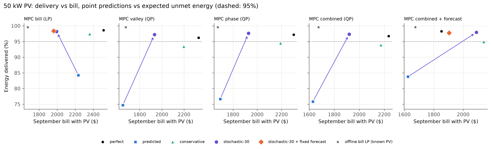
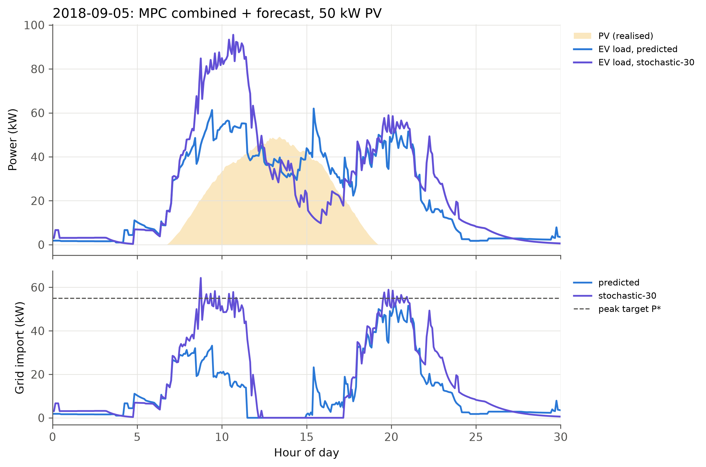
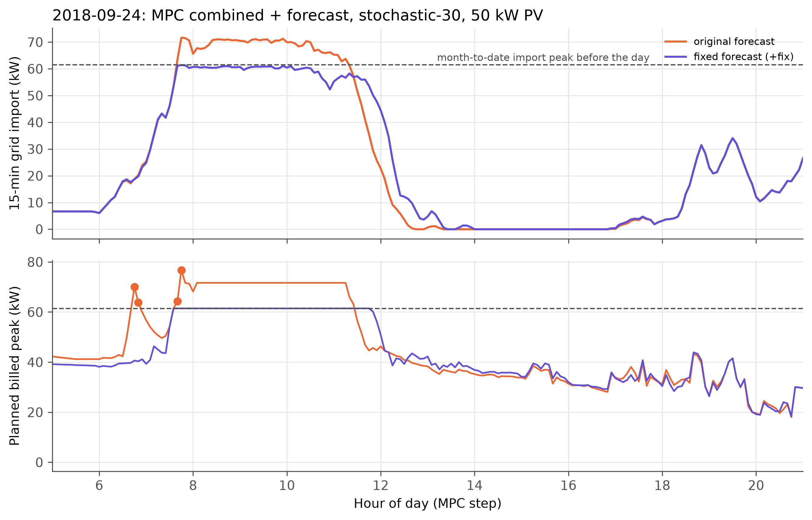

# Stochastic MPC with On-site Solar: Expected Unmet Energy under a Net-Import Bill (E9 extension)

**Optimization Techniques — Group 1**
Tarun Thomas Tom (B230589EC) · Milan V Raj (B231080EC) · Nirmal Thomas Mathew (B231138EC)

*Companion to `REPORT.md` (Section 10, v4, experiment E9) and `REPORT_stochastic.md` (the E8 extension). It combines the two and uses their month, billing and notation. Neither of those files is changed.*

---

## Abstract

E9 added a 50 kW behind-the-meter PV array to the billing-accurate September month and billed net grid import. Under predicted departures and energy, the solar-aware MPCs fell to **75–84%** of the requested energy delivered. They pushed charging into the solar hours, and the EVs that left early missed it. The E8 extension showed that minimising **expected unmet energy** over conditioned historical (stay, kWh) scenarios fixes this without PV, with w = 30 $/kWh at the knee. This extension reruns E9 with that stochastic MPC at w = 30, unchanged, and adds a `conservative` + PV baseline (10 month jobs).

- **Every MPC clears 95% with PV:** delivery is 97.2–98.2%, and 18–19 of the 19 days reach 95% (5–17 days for `conservative`).
- **It is also cheaper than `conservative`:** the bills are $1,919–2,090, which is $49–365 below `conservative` + PV, with import peaks 5–24 kW lower.
- **The four non-forecast MPCs even beat their own perfect-information runs**, by $315–520. The bill LP gains most. Its PV ratchet (import peak 97 kW with perfect information, 87 kW predicted) shrinks to **65 kW**, because front-loading leaves a PV surplus that absorbs forecast shortfalls. The bill LP with stochastic-30 costs $1,994, or 13.2¢ per kWh delivered.
- **The price** is PV self-consumption, which falls from 93–99% to 85–89%. Charging moves into the morning, ahead of the sun, and some midday PV is spilled.
- **Computation:** solves are slower, as in E8 (mean 0.4–1.0 s, P99 7–10 s), but stay far inside the 5-min control period.
- **The forecast MPC lagged because of a bug, now fixed (§5).** A single day, 24 September, raised its import peak by 10.2 kW. Near the end of the 12 h horizon, the ghost EVs for the evening hours kept their full energy in windows only a few periods long. The plan therefore showed a phantom evening peak of 77 kW, which made a higher real peak in the morning look free. The fix (`+fix`) scales ghost energy by the share of its window inside the horizon, prices ghosts at the expected-unmet weight, and counts the share of the current hour still to come. With it, combined + forecast becomes the **cheapest online MPC: $1,904 · 60.2 kW · 97.8%** (previously $2,090 · 72.6 kW). A new **bill LP + fixed forecast** reaches $1,961 · 63.1 kW · 98.4%, against $1,994 · 65.1 kW for the bill LP without the forecast.

---

## 1. Motivation

Two earlier results meet here:

- **E9 (`REPORT.md` §10).** With a net-import bill, the valley term flattens net load and charging moves under the PV curve. With perfect information the QPs cut their September bill by 34–41%. With predicted information they keep the same bill saving, but deliver only 75–84%: PV makes the afternoon even more attractive, so more energy is planned for late in each stay. The bill LP's delivery also drops, from 92.3% without PV to 84.3%. Separately, the bill LP ratchets its billed import peak to 87–97 kW, because it fills import exactly up to the month-to-date floor and any PV shortfall sets a new floor.
- **E8 extension (`REPORT_stochastic.md`).** Planning against the conditioned (stay, kWh) distribution instead of the median, with weight w = 30 $/kWh on expected unmet energy, lifted every MPC to 96.3–97.7% without PV, cheaper than `conservative`.

The question is whether the stochastic MPC still works when midday energy is nearly free. The expected-unmet term pulls charging earlier, toward the morning, and PV pulls it later, toward noon. Which one wins at w = 30, and what does that do to the PV ratchet?

## 2. Setup

Nothing new is modelled. The two existing pieces compose directly in the code:

- **PV and billing (E9).**
  - 50 kW array with synthetic weather seeded per date: 12 clear and 7 partly cloudy September weekdays.
  - The MPC sees a day-ahead forecast blended with a persistence nowcast (2 h decay).
  - Energy cost, the 15-min billed peak, the month-to-date floor and the $P^\star = 54.9$ kW hinge all act on forecast net import $\max(P_t - \widehat{pv}_t, 0)$.
  - The valley term flattens $P_t - \widehat{pv}_t$. Surplus earns nothing.
  - Each simulated day sees only its own day's sun.
- **Expected unmet energy (E8 extension, §2 of `REPORT_stochastic.md`).**
  - For each plugged-in EV: up to 20 historical (stay, kWh) pairs from its arrival-hour bin. They are conditioned every period on stay > elapsed and kWh > delivered, sorted by stay and stratified, with equal weights.
  - The term is the sample-average shortfall $\sum_s \pi_s (k_s - C_i(d_s))^+$ at $w_\text{ES} = 30$ $/kWh, with $E_i \le \max_s k_s$.
  - The finish-by term is dropped for these EVs. Ghost EVs (forecast MPC) keep their deterministic target.

The hinges act on each EV's running energy total. The PV terms act on aggregate power, so the model stays an LP (bill) or QP (the others). `experiment.run` builds the PV-aware `ConvexMPC` whenever `pv_kw > 0`, and adds the scenario term whenever the information level is a stochastic one. The only code changes are in `scripts/run_experiments.py`:
- `--info-solar` accepts the stochastic levels;
- `--presets` with no value skips the offline months.

## 3. Experiment

- **New runs.** The E9 month: September 2018, 19 weekdays, taper batteries, 15-min billed import peak carried over the month, 12 h horizon. It is rerun for the 5 MPCs (bill LP, valley QP, phase QP, combined QP, combined QP + forecast) at two levels:
  - **`stochastic-30`**, the E8 knee, *not* re-tuned for PV;
  - **`conservative`** (P25 stay / P75 kWh), the deterministic baseline that the stochastic level beat without PV. E9 had not run it.
- **Reused rows.** The existing E9 rows (perfect, predicted, and the two joint offline optima with known PV) are reused. They are byte-identical to a backup taken before the run.
- **Checks.** All 10 jobs completed 19 days, with 0 infeasible schedules, 0 solver fallbacks and constraint utilisation ≤ 1.00. The month-to-date import peak carried into each day equals the running maximum of the earlier days, and the daily increments sum to the billed peak. The predictions are the same as E8's `predicted` level, so the differences come from the decision rule only.

## 4. Results

### 4.1 Month totals

**Table 1.** September, 50 kW PV: bill · billed 15-min import peak (kW) · energy delivered. The bill is TOU import cost plus $15.51 × the month's highest 15-min import peak.

| MPC | Perfect | Predicted | Conservative | **Stochastic-30** |
|---|---|---|---|---|
| Bill (LP) | $2,514 · 97.2 · 98.6% | $2,235 · 87.0 · 84.3% | $2,360 · 88.7 · 97.4% | **$1,994 · 65.1 · 98.2%** |
| Valley (QP) | $2,332 · 66.6 · 96.2% | $1,648 · 54.9 · 74.7% | $2,198 · 77.3 · 93.4% | **$1,934 · 62.9 · 97.2%** |
| Phase (QP) | $2,300 · 64.1 · 97.2% | $1,694 · 54.8 · 76.6% | $2,191 · 77.3 · 94.5% | **$1,928 · 61.5 · 97.6%** |
| Combined (QP) | $2,235 · 66.0 · 96.7% | $1,629 · 54.9 · 75.8% | $2,173 · 77.2 · 93.9% | **$1,919 · 61.5 · 97.3%** |
| Combined + forecast | $1,852 · 54.9 · 98.3% | $1,624 · 54.8 · 83.8% | $2,139 · 77.2 · 94.9% | **$2,090 · 72.6 · 97.9%** |
| Offline bill LP (known PV) | $1,675 · 55.1 · 99.6% | | | |
| Offline combined (known PV) | $1,863 · 54.1 · 99.6% | | | |

**Table 2.** Reliability and PV use.

| MPC | Days ≥ 95%: conservative / stochastic-30 | Worst day, stochastic-30 | Bill per kWh delivered: predicted / conservative / stochastic-30 | PV self-consumption: predicted / stochastic-30 |
|---|---|---|---|---|
| Bill (LP) | 17 / **19** | 95.9% | 17.3 / 15.8 / **13.2¢** | 97% / 85% |
| Valley (QP) | 5 / **18** | 94.5% | 14.4 / 15.3 / **12.9¢** | 94% / 89% |
| Phase (QP) | 10 / **19** | 95.2% | 14.4 / 15.1 / **12.8¢** | 95% / 87% |
| Combined (QP) | 8 / **18** | 94.7% | 14.0 / 15.1 / **12.8¢** | 93% / 88% |
| Combined + forecast | 12 / **19** | 95.7% | 12.6 / 14.7 / 13.9¢ | 94% / 87% |

**Table 3.** The same stochastic-30 MPC without and with PV (no-PV rows from `REPORT_stochastic.md` Table 1).

| MPC | No PV | 50 kW PV | Bill change |
|---|---|---|---|
| Bill (LP) | $3,197 · 72.6 · 97.7% | $1,994 · 65.1 · 98.2% | −37.6% |
| Valley (QP) | $3,200 · 70.8 · 96.3% | $1,934 · 62.9 · 97.2% | −39.6% |
| Phase (QP) | $3,257 · 78.2 · 97.5% | $1,928 · 61.5 · 97.6% | −40.8% |
| Combined (QP) | $3,178 · 68.2 · 96.3% | $1,919 · 61.5 · 97.3% | −39.6% |
| Combined + forecast | $3,286 · 80.9 · 97.5% | $2,090 · 72.6 · 97.9% | −36.4% |



*Figure 1. Energy delivered against the September bill with 50 kW PV, per MPC. Each arrow runs from `predicted` to `stochastic-30`. The grey star is the offline bill LP with known PV. Orange diamonds (§5): stochastic-30 with the fixed ghost-EV forecast, in the bill LP panel (bill LP + fixed forecast) and in the combined + forecast panel. Dashed line: 95%.*

### 4.2 Observations

1. **The stochastic term still recovers the energy with PV.** Delivery rises 14–23 points over `predicted` (2.1–3.5 MWh more served over the month) to 97.2–98.2%. That is above every MPC's E9 `predicted` level and above the 95% target. Three MPCs clear 95% on every day and the other two on 18 of 19, with worst days of 94.5–94.7%. Without PV, at the same weight, only three MPCs cleared 95% on every day, and valley and combined managed 15 and 13 days.
2. **It dominates `conservative` with PV for every MPC.**
   - It delivers 0.8–3.8 points more.
   - It bills $253–365 less for the four non-forecast MPCs and $49 less for the forecast MPC.
   - Its import peaks are 61.5–65.1 kW against 77–89 kW (72.6 against 77.2 kW for the forecast MPC).
   - `conservative` again over-reserves: it assumes every EV leaves at the P25 stay for its whole session, so it keeps buying import peak late in the day.
3. **The four non-forecast MPCs beat their own perfect-information runs.**
   - The bill LP is $520 cheaper, and the three QPs are $315–398 cheaper. Delivery is equal or higher, except the bill LP at 98.2% against 98.6%.
   - As without PV, this does not come from better information: with perfect information these MPCs pay the price, valley and phase terms, not just the bill.
   - With PV the effect is larger. With perfect information the QPs push charging toward the solar hours, which are also the 26.7¢ on-peak window, and the bill LP ratchets its import peak (point 4). The expected-unmet term pulls energy into the cheap, PV-free morning instead.
   - The best online bill, $1,919 for the combined QP, is $245 (15%) above the offline bill LP with known PV.
4. **The bill LP's PV ratchet largely disappears.**
   - Its billed import peak is 65.1 kW, against 97.2 kW (perfect), 87.0 kW (predicted) and 88.7 kW (conservative).
   - After the first day, the ratchet increments on partly cloudy days total **10.2 kW**, against 34.1 kW (perfect), 30.6 kW (predicted) and 19.7 kW (conservative). Its demand charge falls to $1,010 from $1,349–1,508.
   - Mechanism: the ratchet arises when the LP fills import exactly up to the floor *net of forecast PV*, so a PV shortfall lands directly on import. Under stochastic-30 the EVs get their energy earlier, and by midday the remaining load sits *below* the PV output (Figure 2: zero import from about 12:00 to 17:00 on the showcase day). A PV dip then first eats the surplus instead of raising import. The spilled PV is, in effect, a free safety margin below the floor. `REPORT.md` §10 proposed such a margin as future work.
5. **Front-loading costs PV self-consumption, not money.**
   - PV used falls from 5.8–6.0 MWh (predicted) to 5.2–5.5 MWh of the 6.2 MWh produced, so self-consumption drops from 93–97% to 85–89%.
   - Import energy rises (9.5–9.9 MWh against 5.7–7.0 MWh), but mostly because 2–3.5 MWh more is delivered. The import energy cost ($958–984) is close to `conservative` ($942–999).
   - Bill per kWh delivered is 12.8–13.2¢ for the four non-forecast MPCs, close to the offline combined optimum (12.2¢). Only combined + forecast at perfect or predicted information is lower (12.3–12.6¢), and the predicted run delivers just 84%.
6. **The QPs now ratchet a little, above $P^\star$.** Under `predicted`, the QPs held the import peak at $P^\star$ all month by under-delivering. At stochastic-30 they end at 61.5–62.9 kW, 6.6–8.0 kW above $P^\star$. Of that, 6.4–7.9 kW comes on partly cloudy days, when morning front-loading meets a weak PV ramp.
7. **The forecast MPC gains least.** Combined + forecast still clears 95% on all 19 days, but its import peak rises to 72.6 kW, with 13 kW of increments on *clear* days after day one. It is therefore the only MPC above its perfect-information bill (+$238), and only $49 below `conservative`. The same pattern appeared without PV (80.9 kW at w = 30). §5 traces 10.2 kW of those 13 kW to a single day and a horizon-edge artefact of the ghost EVs, not to the ghosts' expected demand as such. With the fix, this MPC is the cheapest online one (Table 5).
8. **Gross load peaks are higher but harmless.** The highest 15-min gross peaks are 99–107 kW (75–84 kW for the QPs under `predicted`). They are not billed with PV behind the meter and stay inside the 150 kW transformer limit (utilisation ≤ 1.00).

### 4.3 Showcase day



*Figure 2. 5 September 2018 (a clear day, 360 kWh PV), combined MPC + forecast, `predicted` against `stochastic-30`. Top: gross EV load and realised PV. Bottom: grid import with the $P^\star$ line.*

On 5 September, for the combined + forecast MPC:
- **Delivery:** 85.4% → 97.4%.
- **15-min import peak:** 51.1 → 54.8 kW, still at $P^\star$.
- **Gross 15-min peak:** 59 → 91 kW.

**What moves.** The stochastic MPC charges hard from 08:00 to 12:00, while the sun is still rising. Gross load reaches about 90 kW, with import held near $P^\star$ by the morning PV. By noon most EVs have what they need. Load then falls *below* PV, so import is zero from about 12:00 to 17:00. PV spill rises from 31 to 73 kWh, and PV used falls from 329 to 287 kWh. The point-prediction MPC instead keeps load near the PV curve all afternoon and serves the energy that its median predictions think is still needed, but the EVs that left early are already gone.

The pattern is the same for every MPC that day:
- 26% of the day's energy goes before 10:00 under stochastic-30, against 8–13% under `predicted` for the non-forecast MPCs;
- 72–78 kWh of PV is spilled, against 8–32 kWh.

## 5. The forecast MPC: a horizon-edge phantom peak and its fix

### 5.1 Diagnosis on 24 September

Of the 13 kW that combined + forecast added to its import peak on clear days, 10.2 kW came on one day, 24 September. That day costs $158 of demand charge for the month. It was also a busy morning: 103 arrivals against 92.7 forecast, 52 of them before 10:00 against 46.8 forecast.

The day was re-simulated from the same month-to-date floor (61.45 kW), switching off one suspected cause at a time (`scripts/diag_forecast_0924.py`; the variants patch the code at runtime only):

**Table 4.** 24 September, combined + forecast at stochastic-30 with 50 kW PV, from a 61.45 kW floor.

| Variant | What changes | 15-min import peak (kW) | Delivered |
|---|---|---|---|
| Original (as in the month run) | — | **71.66** | 99.36% |
| No forecast | combined QP without ghost EVs | 61.43 | 98.78% |
| w = 10 | stochastic-10 instead of 30 | 63.00 | 98.83% |
| Current hour | the hour in progress counts only its remaining share, arriving next period | 71.52 | 99.30% |
| Ghosts at $30/kWh | ghost energy priced at the expected-unmet weight, not 100 | 61.39 | 98.87% |
| Ghosts not billed | ghost load excluded from the billed-peak and $P^\star$ terms | 61.39 | 99.00% |
| Horizon edge | ghost energy scaled by the share of its window inside the 12 h horizon | 61.41 | 98.95% |
| **Fixed (`+fix`)** | horizon edge + $30/kWh + current hour | **61.39** | **99.05%** |

Every variant that changes how ghost load is valued at the end of the horizon removes the jump. Dropping the forecast removes it too, but delivers least.

**Mechanism** (Figure 3, bottom):

1. Ghost EVs are one pseudo-EV per hourly arrival bin and phase group. Each arrives at the bin midpoint with the mean stay and the bin's expected energy, at the deterministic unmet weight of $100/kWh.
2. At about 07:40 the horizon ends at 19:40. The ghosts for 17:00, 18:00 and 19:00 (43.6, 50.8 and 46.3 kWh) keep their full energy but have only a few periods left inside the horizon.
3. The plan therefore runs them at their rate caps (34–40 kW each) in the last hours: a **phantom planned peak of 76.7 kW, made almost entirely of ghost load.**
4. The demand charge is one maximum over the whole plan. With the plan's peak already at 76.7 kW, raising the *real* morning load up to that level looks free. The 19 plugged-in EVs are charged at about 93 kW gross, and the realised import reaches 71.7 kW, which becomes the new floor.
5. The phantom peak itself never happens. As the horizon moves forward, those ghost windows widen and their load spreads out. The higher floor, however, is already part of the bill.

**Why pricing alone also works.** At $100/kWh, 1 kW of ghost load kept for one 15-min billing window is worth 0.25 kWh × $100 = $25, which is more than the $15.51/kW demand charge, so buying the peak pays off in the model. At $30/kWh it is worth $7.50, so the model drops ghost energy rather than raising the peak.



*Figure 3. 24 September, combined + forecast, original and fixed ghosts. Top: realised 15-min grid import; dashed: month-to-date import peak before the day. Bottom: the highest billed power in each MPC step's 12 h plan. Filled markers: steps where that planned peak is ghost load above the floor.*

### 5.2 The fix

`+fix` (opt-in algorithm suffix, `ArrivalForecaster(ghost_fix=True)`) changes three things:

- **Horizon edge.** The MPC asks for ghosts only up to now + 12 h. A ghost window cut at the horizon keeps only the share of its energy that falls inside it.
- **Ghost pricing.** In stochastic mode each ghost becomes an EV with one certain scenario, so its unmet energy is priced at the expected-unmet weight (30 $/kWh) like a real EV's. It is no longer the deterministic 100 $/kWh.
- **Current hour.** The bin in progress contributes the share of its arrivals still to come, (bin end − t)/bin length, arriving next period. Before, the whole bin counted until its midpoint and nothing after it. On its own this does not change 24 September, but it removes an inconsistency of the same kind.

The fixed run on 24 September keeps import at 61.39 kW, delivers 99.05%, and has no ghost-driven step above the floor: its highest planned peak is 61.5 kW.

### 5.3 Month results with the fixed forecast

Two jobs were run at stochastic-30 with PV:
- combined + forecast with the fix;
- a new **bill LP + fixed forecast**, which is the bill LP with the same ghost EVs.

Both ran all 19 days with 0 infeasible schedules, 0 fallbacks and utilisation ≤ 1.00. The month-to-date carry is exact, and the existing rows are unchanged.

**Table 5.** September, 50 kW PV, stochastic-30. Import peak increments are after the first day.

| MPC | Bill · import peak (kW) · delivered | Days ≥ 95% · worst day | Bill per kWh delivered | PV self-consumption | Increments: clear / partly cloudy days |
|---|---|---|---|---|---|
| Bill (LP) | $1,994 · 65.1 · 98.2% | 19 · 95.9% | 13.2¢ | 85% | 0.1 / 10.2 kW |
| **Bill (LP) + fixed forecast** | **$1,961 · 63.1 · 98.4%** | 19 · 96.2% | 13.0¢ | 85% | 0 / 8.3 kW |
| Combined (QP) | $1,919 · 61.5 · 97.3% | 18 · 94.7% | 12.8¢ | 88% | 0.3 / 6.4 kW |
| Combined + forecast (original) | $2,090 · 72.6 · 97.9% | 19 · 95.7% | 13.9¢ | 87% | 13.0 / 4.7 kW |
| **Combined + fixed forecast** | **$1,904 · 60.2 · 97.8%** | 19 · 95.6% | 12.7¢ | 87% | 0.1 / 5.3 kW |

1. **The clear-day ratchet is gone.** Combined + forecast now adds 0.1 kW on clear days, against 13.0 kW. Its import peak ends at 60.2 kW, the lowest of all stochastic-30 MPCs. Its bill falls by $186, to $1,904.
2. **The forecast now helps.** The fixed forecast MPC against the combined QP:
   - bill: $15 less;
   - import peak: 1.3 kW lower;
   - delivery: 65 kWh more (97.8% against 97.3%);
   - days at 95% or more: 19 against 18.
   
   It is the cheapest online MPC in this extension. It is $235 below `conservative` + PV, $52 above its own perfect-information run ($1,852), and $229 (14%) above the offline bill LP with known PV.
3. **The bill LP gains a little from the forecast.** With the fixed forecast the bill LP cuts its import peak by 2.0 kW and its bill by $33 (demand $979 against $1,010; energy $982 against $984), and delivers 33 kWh more. All of its remaining ratchet comes on partly cloudy days (8.3 kW): the ghosts do not protect against a PV shortfall.
4. **What is left is PV, not arrivals.** For both fixed-forecast MPCs, the remaining increments come on the 7 partly cloudy days, when morning front-loading meets a weak PV ramp. That is the same residual the QPs show (observation 6).

## 6. Computation

Runs used 10 workers × 1 solver thread. The longest job (combined + forecast) took 3.0 h. The two fixed-forecast jobs ran later, 2 at a time, and took 3.8 h (bill LP) and 4.1 h (combined).

| Level (with PV) | Mean solve (s) | Median (s) | P99 (s) | Max (s) | Time per simulated day |
|---|---|---|---|---|---|
| Predicted (E9) | 0.06–0.11 | 0.02–0.03 | 0.4–0.7 | 1.0 | 0.4–1.3 min |
| Conservative | 0.03–0.08 | 0.02–0.03 | 0.2–0.8 | 1.4 | 0.2–1.0 min |
| Stochastic-30 | 0.44–1.04 | 0.03–0.04 | 7.3–10.4 | 15.4 | 3.0–15.1 min |
| Stochastic-30 + fixed forecast | 1.30–1.43 | 0.04–0.05 | 11.2–12.1 | 21.4 | 8.0–21.3 min |


- **Slowdown.** The stochastic term costs about 10× in mean solve time. The cause is the same as without PV: the time-coupled running totals fill in the KKT factor.
- **Medians stay low.** Periods with few plugged-in EVs remain fast.
- **Headroom.** The slowest call (15.4 s) is 5% of the 5-min period.
- **Compared with no PV.** The PV terms add little: no-PV w = 30 solves averaged 1.25 s, against 0.4–1.0 s here. A likely reason is that fewer hinges are active when EVs finish earlier.
- **The fixed forecast costs solve time.** With the fix, each ghost carries its own expected-shortfall hinge, so the problem has more hinge terms. Mean solve time rises to 1.3–1.4 s (combined + forecast without the fix: 1.04 s). The slowest call, 21.4 s, is 7% of the control period.

## 7. Discussion

- **The two pulls do not fight; they split the day.** The expected-unmet term buys early energy only while the departure risk is high. The PV-aware objective then fills the rest of each stay with cheap net-import energy. At w = 30 the result is a morning push, partly covered by the rising PV, followed by a light afternoon. That schedule is cheaper than either "follow the sun" (predicted, which under-delivers) or "assume early leavers" (conservative, which pays for peak late in the day).
- **Uncertainty about the EVs hedges the uncertainty about PV.** A controller that charges early leaves PV surplus at midday. That surplus is the margin that keeps a forecast error from becoming a new billed peak. This explains why the bill LP, the MPC that was most fragile with PV, gains most. With perfect information about EVs, nothing made the controller keep that margin.
- **The weight carries over from E8.** w = 30 was picked on the no-PV month and reused without re-tuning. It still lands every MPC above 95% and below `conservative`. With PV, the cost of an extra morning kW is partly offset by morning PV, so a lower weight might reach 95% more cheaply. That was not tested.
- **Wasted PV is a real cost only if surplus has value.** Here exported surplus earns nothing, so spilling 0.7–0.9 MWh in a month costs nothing beyond the import it does not displace. Under net metering or with a building load to absorb surplus, the trade-off would shift toward later charging.

## 8. Limitations

- **One weight, tuned without PV and in-sample.** w = 30 comes from the same September, without PV. It is a reasonable default, not an optimised choice for this setting.
- **One weather seed.** The month drew 12 clear and 7 partly cloudy days and no overcast day. On overcast days the morning push would not be covered by PV, and import peaks could rise further.
- **No value for surplus, and no building load.** The loss of self-consumption is free here (§7). Under other export rules it would not be.
- **The E8 extension's limitations still apply.** The scenario distribution is empirical, departures are independent across EVs, and the term is a sample average over 20 scenarios with no guarantee.
- **Offline references** know both the realised PV and the true sessions. The 14–15% gap to the offline bill LP therefore mixes PV and session uncertainty.
- **The forecast fix was found on one day and checked on the same month.** The three changes follow from the mechanism, not from tuning, but they were diagnosed on 24 September and validated on the September month that contains it.
- **Earlier forecast results use the original ghosts.** The combined + forecast rows in `REPORT.md` (E7–E9) and `REPORT_stochastic.md`, and Tables 1–3 here, ran without `+fix`. They are unchanged and reproducible, because the fix is opt-in. Whether the same edge effect inflated those runs (for instance the 80.9 kW import peak without PV at w = 30) was not rerun.

## 9. Conclusions

With 50 kW of behind-the-meter PV and a net-import bill, minimising expected unmet energy at w = 30 $/kWh:

- lifts every MPC from 75–84% to **97.2–98.2%** delivered, with 18–19 of 19 days at 95% or more;
- beats the fixed-quantile `conservative` level on delivery, bill ($49–365 less) and import peak (5–24 kW lower);
- makes the four non-forecast MPCs **cheaper than their own perfect-information runs** ($1,919–1,994 against $2,235–2,514). Front-loading leaves a PV surplus that absorbs PV forecast errors, so the bill LP's ratchet falls from 87–97 kW to 65 kW;
- costs about 10 points of PV self-consumption, which is free under this tariff.

The ghost-EV forecast needs care at the end of the horizon. Ghost energy that does not fit inside the horizon, priced above the demand charge, creates a phantom planned peak that makes a real one look free. With ghosts cut at the horizon and priced like real EVs (`+fix`), the forecast MPC becomes the cheapest online controller: **$1,904 · 60.2 kW · 97.8%**, against $2,090 · 72.6 kW before the fix. The same forecast added to the bill LP saves $33 and 2 kW.

Taken together with the E8 extension: planning against the conditioned departure distribution, not a point prediction, is what makes these MPCs reliable under realistic information, with or without on-site solar.

## 10. Reproduction

Tests (33, including the 5 in `tests/test_stochastic.py`: one runs a PV-aware stochastic MPC, one checks the ghost fix's current-hour share and horizon cut):

```bash
.venv/Scripts/python.exe -m pytest -q
```

The 10 month jobs (about 3 h on 10 workers) merge into `results/month_solar.csv` and `results/month_solar_solve_stats.csv`. Only the (scheduler, level) pairs that were run are replaced, so the E9 perfect, predicted and offline rows are kept. `--presets` with no value skips the offline months.

```bash
EVSCHED_SOLVER_THREADS=1 OPENBLAS_NUM_THREADS=1 .venv/Scripts/python.exe scripts/run_experiments.py month_solar --info-solar conservative stochastic-30 --presets --workers 10
```

Tables and figures: regenerate `notebooks/figures.ipynb`. It writes `results/table_solar.csv` (now with the `conservative`, `stochastic-30` and `+fix` rows), `figures/v4_stochastic_frontier.png`, `figures/v4_stochastic_day.png` and `figures/v4_forecast_fix_day.png` (from `results/diag_0924`).

The fixed-forecast month jobs (§5.3; about 4 h each, single worker):

```bash
EVSCHED_SOLVER_THREADS=1 OPENBLAS_NUM_THREADS=1 .venv/Scripts/python.exe scripts/run_experiments.py month_solar --algos "mpc:combined_qp+forecast+fix" --info-solar stochastic-30 --presets --workers 1
```

```bash
EVSCHED_SOLVER_THREADS=1 OPENBLAS_NUM_THREADS=1 .venv/Scripts/python.exe scripts/run_experiments.py month_solar --algos "mpc:cost_lp+forecast+fix" --info-solar stochastic-30 --presets --workers 1
```

The 24 September diagnosis (§5.1; all 9 variants in parallel, about 20 min). It writes `results/diag_0924/summary.csv` and, per variant, the realised power (`.npz`) and every MPC step's plan (`_plan.csv`). Variant names can be passed to run a subset:

```bash
.venv/Scripts/python.exe scripts/diag_forecast_0924.py
```

```bash
.venv/Scripts/jupyter.exe nbconvert --execute --inplace notebooks/figures.ipynb
```
