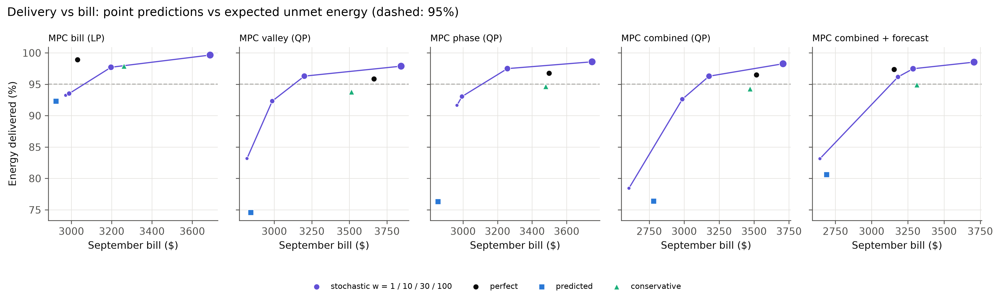
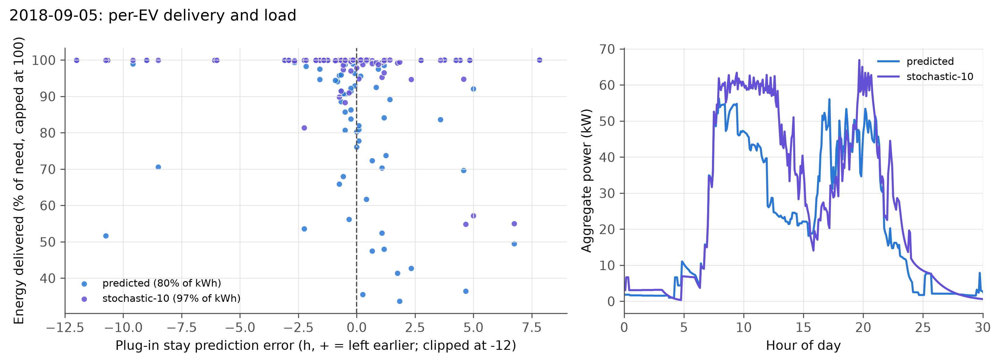

# Stochastic MPC: Minimising Expected Unmet Energy under Uncertain Departures (E8 extension)

**Optimization Techniques — Group 1**
Tarun Thomas Tom (B230589EC) · Milan V Raj (B231080EC) · Nirmal Thomas Mathew (B231138EC)

*Companion to `REPORT.md`. It extends Section 9 (v3, imperfect information, experiment E8) and uses the same month, billing and notation. `REPORT.md` itself is unchanged.*

---

## Abstract

Under predicted departures and energy (E8), the convex MPCs that plan against the arrival-hour median deliver only 74–81% (QPs) and 92% (bill LP) of the requested energy. This extension replaces the point prediction with a **sample-average stochastic term**: each MPC minimises the expected unmet energy over up to 20 historical (stay, kWh) scenarios per EV. The scenarios are re-conditioned every period on what has been observed (still plugged in, not yet finished). The term is a set of hinge constraints on a per-EV running total, so every MPC stays an LP/QP.

We ran the September 2018 month for the five MPCs at weights 1, 10, 30 and 100 $/kWh (20 month jobs). The predictions are the same as in E8, so only the decision rule changes.
- **w = 30 (the knee):** every MPC delivers **96.3–97.7%**, and three of the five clear 95% on all 19 days. Billed peaks are 68–81 kW and bills are $25–314 below `conservative`, which delivers 93.8–97.9% at 80–91 kW. This is the cheapest weight tested that clears the 95% target for every MPC.
- **w = 10:** the flattening QPs rise to 92–93% delivered while keeping the billed peak at the 54.9 kW target. Their bill is $480–530 below the `conservative` level and their cost per kWh is the lowest of any level (21¢). The combined QP with arrival forecast reaches **96.2%**: more than `conservative` (94.9%) for $130 less and with a 12 kW lower peak.
- **w = 100:** every MPC delivers 98–99.7%, but the billed peak doubles to 114–122 kW, so the bill rises above `conservative`.
- **Computation:** solves are about 15× slower, because the time-coupled running total fills in the KKT factor, but still about 2 s on average, well inside the 5-min control period.

---

## 1. Motivation

In E8 the controller does not know when each EV will leave or how much energy it needs. It sees predictions built from the previous 28 weekdays (`REPORT.md` §9.2). With **point predictions** (the arrival-hour median), the convex MPCs deliver only 74–81% of the energy (the QPs) and 92% (the bill LP). Under perfect information the same MPCs deliver 96–99%.

The cause is structural, not a bad predictor:

- **Departures.** The plug-in stay error is 2.6 h on average, and 49% of the EVs leave *earlier* than predicted. The flattening MPCs spread each car's energy evenly up to its predicted departure. The share planned for the end of the stay is never delivered when the car leaves early.
- **Energy.** Energy per session is right-skewed. The sum of per-session medians undercounts a day's need by 10% on average and by 29% on the worst day. The larger requests are discovered only once the median amount has been delivered.

The `conservative` level (P25 stay, P75 kWh) recovers 94–98% of the energy, but it is a blunt fix. *Every* EV is assumed to leave early and need a lot, whatever its arrival time and whatever has been observed since, and the billed peak rises from about 62 kW to 80–91 kW.

This extension keeps the whole conditional distribution instead of one quantile. The MPC minimises the **expected** unmet energy over scenarios of (stay, kWh). This is a sample-average stochastic program, and it stays an LP/QP.

## 2. Formulation

### 2.1 Scenarios

Take an EV that arrived at $a$ and, at MPC time $t$, has been plugged in for $t-a$ periods and has received $\delta$ kWh. Its scenarios come from the same history as the point predictor: the weekday sessions of the 28 days before the target day, binned by arrival hour $b$. A historical session $(\tau_j, e_j)$ (stay in periods, kWh) is a valid scenario only if it is consistent with what has been observed:

$$\tau_j > t-a \quad\text{(still plugged in)}, \qquad e_j > \delta \quad\text{(not finished)}.$$

- **Widening.** If fewer than 10 pairs remain, the window widens to $b\pm1, b\pm2, \dots$ until 10 remain, as the point predictor does at plug-in. If no historical pair is consistent anywhere, the EV gets one scenario 30 min ahead needing 0.5 kWh more.
- **Stratification.** The consistent pairs are sorted by stay, and at most 20 are kept, evenly spaced. Each gets weight $\pi_s = 1/S$ with $S\le 20$.
- **Joint pairs.** Stay and energy are kept as pairs. Long stays tend to carry more energy, and the pairs keep that correlation. Sampling the stay and the kWh independently would lose it.
- **Conditioning replaces the ad-hoc updates.** The point predictor needs two separate update rules (overstay, larger request). Here, conditioning on $\tau > t-a$ and $e > \delta$ gives the posterior directly at every period.

For scenario $s$ the MPC uses

$$d_s = \min(\tau_s - (t-a),\; T), \qquad k_s = e_s - \delta,$$

the periods left until departure (capped at the 12 h horizon $T$, as for every other level) and the energy still needed.

### 2.2 Expected unmet energy

With $e_{i\tau} = V_i R_{i\tau}\Delta t/1000$ the energy delivered to EV $i$ in period $\tau$, the energy delivered before scenario departure $d_s$ is $C_i(d_s) = \sum_{\tau<d_s} e_{i\tau}$. The shortfall in scenario $s$ is $(k_s - C_i(d_s))^+$, and its sample average is

$$\mathbb{E}[\text{unmet}_i] \approx \sum_s \pi_s \bigl(k_s - C_i(d_s)\bigr)^+ .$$

It enters the MPC through hinge variables:

$$
\begin{aligned}
& z_{is} \ge k_{is} - C_i(d_{is}),\quad z_{is}\ge 0, \\
& \text{expected} = \sum_i\sum_s \pi_{is} z_{is}, \\
& \textstyle\sum_\tau e_{i\tau} \le \max_s k_{is} \quad\text{(no energy beyond the largest plausible need)}.
\end{aligned}
$$

For these EVs, the term $w_{\text{ES}}\cdot\text{expected}$ replaces the soft energy target $E_i + u_i = \hat e_i$ and the finish-by term. A single-deadline finish-by would count the same risk twice. Each EV's window $\text{ub}$ runs to $\max_s d_s$ instead of the predicted departure. Everything else is unchanged:
- the TOU energy cost;
- the 15-min billed demand with month-to-date floor and $P^\star$ hinge;
- the valley and phase terms;
- the SOC network limits;
- the rampdown bounds;
- the forecast ghost EVs, which keep their deterministic soft target.

The expected shortfall is convex and piecewise linear in $R$, so an LP stays an LP and a QP stays a QP.

**What the weight means.** At the margin, one kWh delivered before period $d$ instead of after it saves $w_{\text{ES}}\cdot\Pr(D \le d)$, the weight times the probability that the car has left by then. The MPC charges early exactly where that saving beats the price, demand and flatness costs of charging early. With $w_{\text{ES}}=1$ $/kWh, a 50% chance of an early departure is worth 0.50 $/kWh. That is more than the gap between the TOU mid-peak and on-peak prices (0.17 $/kWh), but a higher billed peak costs $15.51 per kW for the whole month. With $w_{\text{ES}}=100$ (the scale of the deterministic unmet weight), almost any risk of departure outweighs every cost.

### 2.3 Implementation

- `SessionPredictor.scenarios(arrival, elapsed, delivered)` in `estimates.py` returns $(d_s, k_s, \pi_s)$. It is cached per (arrival bin, elapsed periods, delivered rounded to 0.1 kWh).
- `EVBlock.scenarios` and `Weights.expected` are in `model.py`. $C_i(\cdot)$ is a per-EV running total over the EV's window entries (the same sparse recursion as the taper constraint), and each hinge selects one entry of it.
- `ConvexMPC(stochastic=True)` in `schedulers.py` builds the scenarios for each plugged-in EV, sets the window and the energy cap, and drops its finish-by.
- `experiment.py` adds the information levels `stochastic-1`, `stochastic-10`, `stochastic-30` and `stochastic-100`. They use the `predicted` interface (median `SessionInfo`, so the prediction statistics stay comparable) plus the scenario term at that weight.

## 3. Experiment

The E8 month is rerun for September 2018 (19 weekdays), with the same taper batteries, 15-min billed peak carried over the month, $P^\star = 54.9$ kW and 12 h horizon. The 5 MPCs (bill LP, valley QP, phase QP, combined QP, combined QP + forecast) first ran at w = 1, 10 and 100 (15 month jobs). Then w = 30 was added (5 more jobs) to locate the knee between 10 and 100. EDF, LLF and round robin are not rerun because they cannot use a distribution. They already deliver above 99.6% under predictions (`REPORT.md` §9.5). The comparison rows are E7 (perfect) and the E8 `predicted` and `conservative` levels.

All 15 jobs completed the 19 days with 0 infeasible schedules, 0 solver fallbacks and constraint utilisation ≤ 1.00. The month-to-date peak carried into each day matches the running maximum of the earlier days. The prediction statistics are identical to the `predicted` level (stay MAE 155 min, 49% of EVs leave early, 51% need more than predicted), so every difference below comes from how the MPC uses the predictions, not from better ones.

## 4. Results

### 4.1 Month totals

Bill = TOU energy + $15.51/kW × the month's highest 15-min peak (`REPORT.md` §8). Delivered is the share of all 76.8 MWh requested in September. The worst day is the lowest daily delivery. The `perfect` rows are E7 and the `predicted` and `conservative` rows are E8, unchanged.

| MPC | Level | Bill ($) | vs conservative ($) | Billed peak (kW) | Delivered (%) | Worst day (%) | Bill per kWh ($) |
|---|---|---:|---:|---:|---:|---:|---:|
| Bill LP | perfect | 3,031 | −231 | 70.3 | 98.9 | 97.7 | 0.199 |
|  | predicted | 2,924 | −337 | 54.9 | 92.3 | 89.2 | 0.206 |
|  | conservative | 3,261 | 0 | 79.7 | 97.9 | 95.6 | 0.217 |
|  | stochastic w = 1 | 2,972 | −289 | 54.9 | 93.2 | 89.1 | 0.207 |
|  | stochastic w = 10 | 2,989 | −272 | 54.9 | 93.5 | 89.6 | 0.208 |
|  | stochastic w = 30 | 3,197 | −64 | 72.6 | **97.7** | 95.3 | 0.213 |
|  | stochastic w = 100 | 3,689 | +427 | 115.6 | **99.7** | 98.5 | 0.241 |
| Valley QP | perfect | 3,663 | +149 | 78.5 | 95.9 | 94.8 | 0.249 |
|  | predicted | 2,844 | −670 | 62.5 | 74.6 | 60.3 | 0.248 |
|  | conservative | 3,514 | 0 | 90.9 | 93.8 | 87.8 | 0.244 |
|  | stochastic w = 1 | 2,819 | −696 | 54.6 | 83.2 | 78.0 | 0.221 |
|  | stochastic w = 10 | 2,987 | −528 | 54.9 | 92.3 | 88.4 | 0.211 |
|  | stochastic w = 30 | 3,200 | −314 | 70.8 | **96.3** | 92.3 | 0.216 |
|  | stochastic w = 100 | 3,844 | +330 | 122.4 | **97.9** | 94.7 | 0.256 |
| Phase QP | perfect | 3,498 | +20 | 68.6 | 96.8 | 95.5 | 0.235 |
|  | predicted | 2,855 | −623 | 60.5 | 76.3 | 63.1 | 0.243 |
|  | conservative | 3,479 | 0 | 89.1 | 94.7 | 88.6 | 0.239 |
|  | stochastic w = 1 | 2,965 | −513 | 54.9 | 91.6 | 88.0 | 0.211 |
|  | stochastic w = 10 | 2,994 | −484 | 54.9 | 93.0 | 89.3 | 0.209 |
|  | stochastic w = 30 | 3,257 | −221 | 78.2 | **97.5** | 95.1 | 0.217 |
|  | stochastic w = 100 | 3,748 | +269 | 117.6 | **98.6** | 96.5 | 0.247 |
| Combined QP | perfect | 3,518 | +47 | 77.6 | 96.5 | 95.5 | 0.237 |
|  | predicted | 2,782 | −688 | 62.1 | 76.4 | 63.3 | 0.237 |
|  | conservative | 3,470 | 0 | 89.9 | 94.3 | 88.4 | 0.239 |
|  | stochastic w = 1 | 2,605 | −865 | 54.5 | 78.4 | 73.8 | 0.216 |
|  | stochastic w = 10 | 2,987 | −483 | 54.9 | 92.6 | 89.0 | 0.210 |
|  | stochastic w = 30 | 3,178 | −292 | 68.2 | **96.3** | 93.4 | 0.215 |
|  | stochastic w = 100 | 3,708 | +237 | 114.3 | **98.3** | 96.0 | 0.246 |
| Combined QP + forecast | perfect | 3,155 | −157 | 67.4 | 97.4 | 96.7 | 0.211 |
|  | predicted | 2,688 | −623 | 61.3 | 80.6 | 69.4 | 0.217 |
|  | conservative | 3,312 | 0 | 81.9 | 94.9 | 88.9 | 0.227 |
|  | stochastic w = 1 | 2,643 | −669 | 54.9 | 83.1 | 78.6 | 0.207 |
|  | stochastic w = 10 | 3,182 | −130 | 69.5 | **96.2** | 93.4 | 0.215 |
|  | stochastic w = 30 | 3,286 | −25 | 80.9 | **97.5** | 95.4 | 0.219 |
|  | stochastic w = 100 | 3,707 | +396 | 115.5 | **98.5** | 96.6 | 0.245 |

Days at or above 95% delivery (out of 19):

| MPC | predicted | conservative | w = 1 | w = 10 | w = 30 | w = 100 |
|---|---:|---:|---:|---:|---:|---:|
| Bill LP | 1 | 19 | 7 | 9 | 19 | 19 |
| Valley QP | 0 | 8 | 0 | 4 | 15 | 18 |
| Phase QP | 0 | 10 | 1 | 8 | 19 | 19 |
| Combined QP | 0 | 9 | 0 | 5 | 13 | 19 |
| Combined QP + forecast | 0 | 12 | 0 | 14 | 19 | 19 |



*Figure 1. September bill against energy delivered for each MPC. The purple line joins the stochastic levels w = 1 → 10 → 30 → 100 (growing markers). Perfect, predicted and conservative are the E7/E8 points. Dashed line: 95%.*

### 4.2 Observations

1. **The flattening QPs recover most of the lost energy at w = 10, at no extra billed peak.** Valley, phase and combined QP rise from 74–76% (`predicted`) to 92–93%. The billed peak stays at $P^\star = 54.9$ kW and the bill is about $2,990 for all three. That is $480–530 below `conservative`, which delivers only 1.5–2 points more. Their bill per kWh delivered ($0.209–0.211) is the lowest of any level, perfect information included. Two things give that. First, 2.5–2.7 MWh more is served under the same billed peak. Second, the expected-shortfall term pulls the energy of the likely early leavers forward: on 5 September (combined QP), the share delivered in the cheap 08:00–12:00 mid-peak window rises from 25% to 27%, and the on-peak 12:00–18:00 share falls from 34% to 31%.
2. **Combined QP + forecast at w = 10 dominates `conservative`.** It delivers 96.2% (conservative: 94.9%), with 14 of 19 days above 95% (conservative: 12), a billed peak of 69.5 kW (81.9 kW) and a bill that is $130 lower. It is the only MPC above the 95% target at w = 10. The forecast ghosts reserve capacity for the later arrivals, so front-loading the current EVs costs less.
3. **w = 30 is the knee: ≥ 95% for every MPC, cheaper than `conservative`.**
   - Every MPC delivers 96.3–97.7%. The bill LP, phase QP and forecast MPC clear 95% on all 19 days; valley QP does on 15 and combined QP on 13.
   - The billed peak rises above $P^\star$ only as far as the risk pays for: 68–81 kW, against 80–91 kW for `conservative` and 114–122 kW at w = 100.
   - Against `conservative`, every MPC is cheaper ($25 for the forecast MPC up to $314 for valley QP) and the four QPs also deliver 2.0–2.8 points more. The bill LP matches conservative's delivery (97.7% against 97.9%) for $64 less and a 7 kW lower peak.
   - The three flattening QPs even beat their own perfect-information bills, by $240–460, at similar delivery. This is not better information. With true departures, those objectives buy flatness and pay $190–390 more for energy over the month. The expected-shortfall term pulls energy into the cheaper morning. The bill LP and the forecast MPC, which do weigh cost, still cost $130–170 more than under perfect information.
4. **w = 100 reaches the target everywhere, at a high price.** Every MPC delivers 97.9–99.7%, and on at least 18 of 19 days. The bill LP reaches 99.7%, above its own perfect-information run. But the billed peak doubles to 114–122 kW, so the bill is $240–430 *above* `conservative` and $180–660 above perfect information. On 5 September (combined QP), the 08:00–12:00 window takes 39% of the day's energy at w = 100 (27% at w = 10), and the peak comes at about 09:15, when the morning arrivals all charge at once. The energy cost is actually *lower* than at w = 10 (cheap mornings), so all of the extra cost is demand charge.
5. **w = 1 is too weak for most MPCs.** One expected kWh is then worth less than the valley/flatness penalties. Combined QP stays at 78% and valley QP at 83%. Phase QP is the exception (91.6% already at w = 1), because its preset puts only 0.1 on the valley term. The bill LP barely moves between w = 1 and w = 10 (93.2 → 93.5%).
6. **Why w = 10 stops short of 95%: the billed-peak target.** At w = 1 and 10, every MPC but the forecast one keeps the billed peak exactly at $P^\star = 54.9$ kW. Raising the month's peak by 1 kW costs $15.51 for the whole month, and at w = 10 the expected kWh it would save is not worth that. Even with perfect information the MPCs need 67–78 kW to deliver 96–99%. Getting past 95% with uncertain departures therefore means paying for a peak above $P^\star$. The weight decides how much: w = 10 pays almost none, w = 100 far too much, and w = 30 lands near the perfect-information peaks (67–78 kW).
7. **The forecast MPC's peak ratchets.** At w = 10 its daily peak climbs from 61 kW (4 Sept) to 69.5 kW (26 Sept), and at w = 30 from 72 to 81 kW. Once a day has set a higher month-to-date peak, later days can use up to it for free, so each small increase is kept for the rest of the month.

### 4.3 Showcase day: who gets their energy



*Figure 2. 5 September 2018, combined QP + forecast, `predicted` vs stochastic w = 10. Left: each EV's delivery against its plug-in stay error. Positive means the EV left earlier than predicted. The axis is clipped at −12 h (one EV stayed 2 days) and delivery is capped at 100% (a few ~1 kWh requests overshoot by part of a 5-min period). Right: aggregate power.*

On this day the stochastic MPC delivers **97.0%** of the 89 EVs' energy (point predictions: 80.4%), with a billed peak of 61.8 kW (54.8 kW).
- **Early leavers gain most.** The 37 EVs that left earlier than predicted get 95.1% of their energy (69.5% under point predictions). Those leaving more than 2 h early get 85.8% (67.7%).
- **Fewer badly served EVs.** EVs below 80% of their need drop from 22 to 3.
- **Where the energy goes.** The load plot shows it: the stochastic MPC runs at about 60 kW from 08:00 to 12:30, while the point-prediction MPC has fallen to 25 kW by noon and pushes the rest into the on-peak afternoon, when many of those cars have already left.

## 5. Computation

| Level | Mean solve (s) | Median (s) | P99 (s) | Max (s) | Mean wall per day (s) |
|---|---:|---:|---:|---:|---:|
| predicted (5 MPCs) | 0.12 | 0.04 | 0.67 | 1.42 | 36–62 |
| stochastic w = 1 | 1.99 | 0.22 | 11.97 | 21.68 | 413–957 |
| stochastic w = 10 | 1.90 | 0.21 | 12.86 | 24.90 | 376–900 |
| stochastic w = 30 | 1.25 | 0.16 | 8.88 | 14.33 | 285–600 |
| stochastic w = 100 | 1.38 | 0.20 | 11.90 | 20.17 | 218–751 |

*Per-solve times exclude periods with no active EV. The wall range runs from the bill LP (fastest) to combined QP + forecast (slowest).*

- **Each solve is about 15× slower than the deterministic MPC** (mean 1.3–2.0 s against 0.12 s). The P99 is 9–13 s against 0.7 s. Every one is still well inside the 5-min control period, so the controller is real-time feasible. A simulated month, however, needs 1.2–5.1 h per job instead of 11–20 min. The first 15 jobs took 47 CPU-hours, 5.1 h of wall time on 12 workers. The 5 jobs at w = 30 took 1.5–3.2 h each.
- **The cause is fill-in, not problem size.** The scenario term adds at most about 50 EVs × 20 hinges and one running-total variable per window entry, which is a small number of rows. But the running total couples every period of an EV's window to the next, and each hinge reads one point of that chain. In the KKT system of OSQP/QDLDL, the AMD ordering then turns the time-coupled chains into dense blocks: the factor grows from about 0.46 M to 3.4 M non-zeros for a typical busy-hour problem.
- **Alternatives tried, none faster:**
  - writing $C_i(d_s)$ directly as a sum over the window (6.3 M non-zeros, slower);
  - hourly or interval blocks (3.0 M);
  - the faer backend;
  - looser tolerances;
  - SCS.
  - Cutting to 10 scenarios gave only a small gain.
  - The formulation was therefore kept as designed.
- **Larger weights solve faster** (mean 1.9–2.0 s at w ≤ 10, 1.25–1.4 s at w ≥ 30). At large weights most hinges are inactive, because the EV is front-loaded past every scenario, and the solver converges in fewer iterations.

## 6. Discussion

- **The distribution, not a better point forecast, is what recovers the energy.** The predictor, its errors and its data are the same as in `predicted`. Only the decision rule changed, from "plan to the median" to "minimise expected shortfall". At w = 10 that alone moves the QPs from 75% to 92–93% at the same billed peak, and the forecast MPC to 96%.
- **Conditioning beats a fixed quantile.** `conservative` treats every EV as leaving at the P25 stay for its whole session. The scenarios are re-conditioned every period: an EV still plugged in after 4 h loses every scenario shorter than 4 h, and its risk falls. The MPC therefore front-loads only where the remaining risk justifies it. At comparable delivery, this saves $130 (forecast MPC) to over $480 (the other QPs at 1.5–2 points less delivery) against `conservative`.
- **The weight is a price on reliability.** w = 1 / 10 / 30 / 100 $/kWh traces a delivery–bill frontier (Figure 1). For a site operator, the choice is between how much a missed kWh costs in customer terms and $15.51 per kW of extra monthly peak. With this tariff and fleet, the knee is near w = 30: about a third of the deterministic unmet weight (100 $/kWh) and about 2× the monthly demand charge per kW.
- **The bill LP needs w ≥ 30 to move.** It already front-loads into the cheap mornings under point predictions (92%). The remaining shortfall needs extra peak, which w = 10 does not buy (93.5%) and w = 30 does (97.7% at 72.6 kW).

## 7. Limitations

- **Empirical distribution.** The scenarios are past sessions of the same arrival hour from 28 weekdays. They carry no user identity, weather or day-of-week effects. Thin tails are widened across neighbouring hours, so late, unusual sessions borrow from other hours.
- **Independence across EVs.** Each EV's scenarios are drawn and weighted independently. Correlated departures (for example a whole group leaving early on a Friday) are not modelled, so a bad day for many EVs at once is underweighted.
- **Sample average with 20 scenarios.** The term is a sample-average approximation with at most 20 equally weighted scenarios. It has no confidence guarantee and is not a chance constraint. A tail-risk measure (CVaR) over the same scenarios would protect the worst cases more directly.
- **Coarse weight grid, tuned on the test month.** Four weights were run. w = 30 was chosen after seeing the w = 10 and w = 100 results for the same September, so it is tuned in-sample. A fair deployment would pick the weight on an earlier month.
- **Runtime.** Each solve is about 15× slower (§5). That is fine for a 5-min controller but makes month-long sweeps expensive. A warm-started, custom-ordered KKT solve, or a solver that exploits the banded time structure, would be needed for larger sites.
- **No PV.** E9 solar is not combined with this level.

## 8. Conclusions

Minimising expected unmet energy over conditioned historical (stay, kWh) scenarios keeps the MPC an LP/QP. With the same predictions as `predicted`, it closes most of the information gap:

- at **w = 10** the flattening QPs deliver 92–93% (up from 74–76%) at the target peak and the lowest bill per kWh of any level, and the forecast MPC already delivers 96.2%;
- at **w = 30** every MPC delivers **96.3–97.7%**, at billed peaks of 68–81 kW and $25–314 below `conservative`;
- at **w = 100** every MPC delivers 98–99.7%, but the morning rush doubles the billed peak and the bill rises above `conservative`.

The 95% target is reached for every MPC at w = 30, and that is cheaper than the fixed-quantile `conservative` level. The weight acts as a price on reliability: it sets how much of the monthly demand charge the controller will spend to protect against early departures.

## 9. Reproduction

Tests (31, including the 3 in `tests/test_stochastic.py`):

```bash
.venv/Scripts/python.exe -m pytest -q
```

The 20 month jobs (about 5 h on 12 workers for the first 15, then 3.2 h for w = 30) append to `results/month_info.csv` and `results/month_info_solve_stats.csv`:

```bash
EVSCHED_SOLVER_THREADS=1 OPENBLAS_NUM_THREADS=1 .venv/Scripts/python.exe scripts/run_experiments.py month_info --info stochastic-1 stochastic-10 stochastic-30 stochastic-100 --workers 12
```

The showcase day writes `results/stochastic_showcase.csv`:

```bash
EVSCHED_SOLVER_THREADS=1 .venv/Scripts/python.exe scripts/run_experiments.py stochastic_showcase
```

Tables and figures: regenerate `notebooks/figures.ipynb`, which writes `results/table_info.csv`, `figures/v3_stochastic_frontier.png` and `figures/v3_stochastic_day.png`:

```bash
.venv/Scripts/jupyter.exe nbconvert --execute --inplace notebooks/figures.ipynb
```
